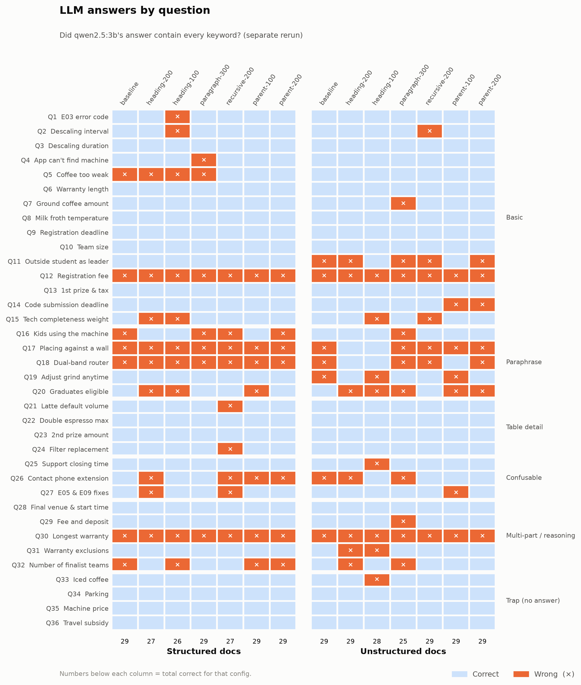
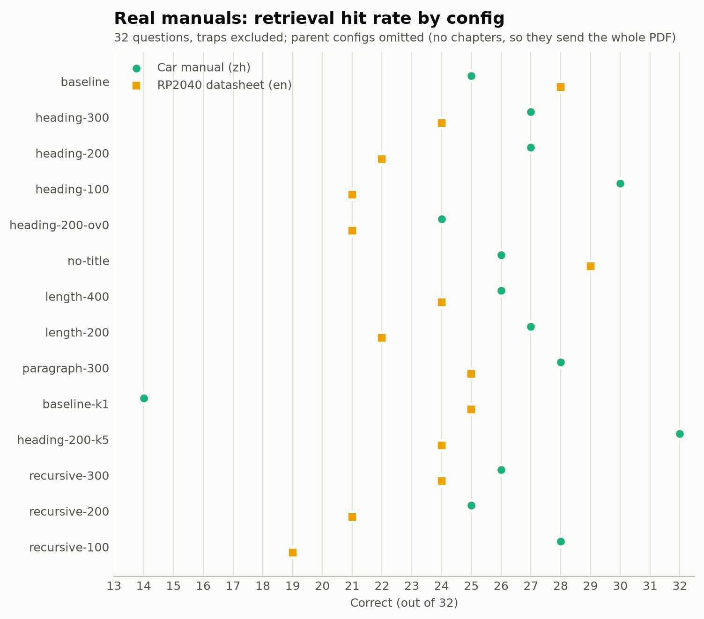
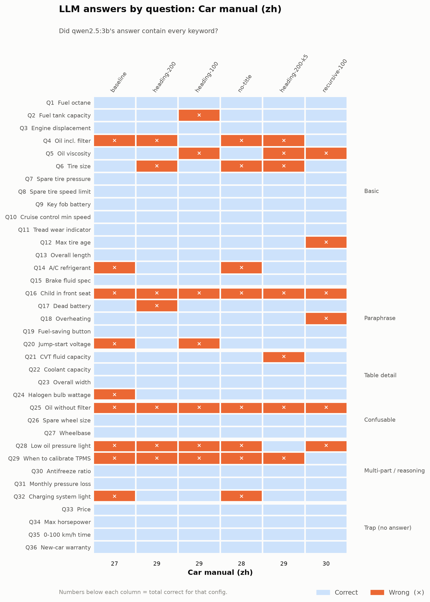

# 切段實驗：數據與結果

## 實驗目的

比較不同的切段方式、段落長度、重疊字數、段首標題、Top-K，對 RAG **檢索命中率**和 **LLM 回答正確率**的影響。

## 實驗設定

| 項目 | 設定 |
|---|---|
| 知識庫 | `data/` 裡 2 份 Markdown 文件：咖啡機使用手冊、黑客松活動辦法（每個 `## ` 章節約 50～390 字） |
| Embedding | Ollama `bge-m3`，cosine 相似度 |
| LLM | Ollama `qwen2.5:3b`，temperature 0.1 |
| 測試題 | `evaluate.py` 的 36 題：32 題一般題 + 4 題陷阱題（知識庫裡沒有答案） |
| 執行程式 | `experiment.py`，原始數據在 `results/` |

### 測試題組成

| 類型 | 題號 | 題數 |
|---|---|---|
| 基本題（文件裡直接寫的事實） | 1～15 | 15 |
| 換句話說（問法和文件用字不同） | 16～20 | 5 |
| 表格細節 | 21～24 | 4 |
| 容易混淆（兩份文件都有類似資訊） | 25～27 | 3 |
| 跨段落 / 推理 / 列舉 | 28～32 | 5 |
| 陷阱題 | 33～36 | 4 |

完整題目與標準答案見 `測試問題與標準答案.md`。

### 評分方式

- **檢索命中**：取回的段落合起來，有沒有包含該題所有關鍵字。只算 32 題一般題。
- **回答正確**：LLM 的回答有沒有包含所有關鍵字。36 題都算，陷阱題要回答「沒有提到」。
- **每題上下文字數**：平均每題交給 LLM 多少字。越少代表越省，也越不容易被不相關內容干擾。

### 比較的設定

| 設定 | 切段方式 | 每段上限 | 重疊 | 段首標題 | Top-K | 備註 |
|---|---|---|---|---|---|---|
| baseline | heading | 600 | 100 | ✅ | 3 | 最初的設定 |
| heading-300 / 200 / 100 | heading | 300 / 200 / 100 | 50 / 50 / 30 | ✅ | 3 | heading-200 是目前 `rag_core.py` 的設定 |
| heading-200-ov0 | heading | 200 | 0 | ✅ | 3 | 不重疊 |
| no-title | heading | 600 | 100 | ❌ | 3 | 拿掉段首標題 |
| length-400 / 200 | length | 400 / 200 | 100 / 50 | ✅ | 3 | 不看章節硬切 |
| paragraph-300 | paragraph | 300 | 50 | ✅ | 3 | 依空行切再合併 |
| baseline-k1 | heading | 600 | 100 | ✅ | 1 | |
| heading-200-k5 | heading | 200 | 50 | ✅ | 5 | |
| recursive-300 / 200 / 100 | recursive | 300 / 200 / 100 | 50 / 50 / 30 | ✅ | 3 | 遞迴切分 |
| parent-100 / 200 | heading | 100 / 200 | 30 / 50 | ✅ | 3 | 小段檢索、大段回答 |
| parent-100-k2 | heading | 100 | 30 | ✅ | 2 | 小段檢索、大段回答 |

註：baseline 每段上限 600 字，但所有章節都不到 600 字，所以其實沒有任何章節被再切小，等於「一個章節一段」。

## 結果一：檢索命中（32 題一般題）

資料來源：`results/experiment_20261020_142058.csv`

| 設定 | 段數 | 平均字數 | 檢索命中 | 每題上下文字數 | 沒命中的題號 |
|---|---|---|---|---|---|
| baseline | 25 | 244 | 31/32 | 963 | 5 |
| heading-300 | 29 | 222 | 32/32 | 784 | - |
| heading-200 | 41 | 183 | 32/32 | 594 | - |
| heading-100 | 74 | 126 | 32/32 | 391 | - |
| heading-200-ov0 | 40 | 166 | 31/32 | 583 | 5 |
| no-title | 25 | 206 | 30/32 | 849 | 16, 17 |
| length-400 | 17 | 420 | 29/32 | 1255 | 5, 16, 17 |
| length-200 | 35 | 222 | 29/32 | 673 | 4, 5, 19 |
| paragraph-300 | 22 | 263 | 32/32 | 827 | - |
| baseline-k1 | 25 | 244 | 29/32 | 322 | 5, 14, 28 |
| heading-200-k5 | 41 | 183 | 32/32 | 984 | - |
| recursive-300 | 24 | 262 | 32/32 | 837 | - |
| recursive-200 | 38 | 190 | 32/32 | 584 | - |
| recursive-100 | 74 | 111 | 30/32 | 350 | 2, 29 |
| parent-100 | 74 | 126 | 32/32 | 968 | - |
| parent-200 | 41 | 183 | 32/32 | 947 | - |
| parent-100-k2 | 74 | 126 | 31/32 | 670 | 19 |

### 觀察

1. **段落切小有幫助，但不能太碎。** baseline 漏掉第 5 題（咖啡太淡怎麼調）。依章節切到 100～300 字都能全部命中，上下文還更少。遞迴切分切到 100 字反而漏了 2 題，因為句子被切得太碎。
2. **依結構切比硬切好。** 不看章節硬切（length）漏了 3 題，依章節（heading）、段落（paragraph）、遞迴（recursive）切都能全部命中。
3. **段首標題很重要。** 拿掉標題後，換句話說的第 16、17 題就找不到了。
4. **重疊有幫助。** 同樣 200 字，重疊 0 字就漏掉第 5 題。
5. **Top-K 不能太小。** 只取 1 段會漏 3 題，第 28 題跨段落的題目尤其需要多段。
6. **最省上下文的全命中設定**是 heading-100（391 字），其次是 recursive-200（584 字）和 heading-200（594 字），都不到 baseline 的 2/3。

## 結果二：LLM 回答正確（36 題）

LLM 很慢，所以只挑 6 組代表性的設定來跑。

資料來源：`results/experiment_20261020_143644.csv`
指令：`python experiment.py --llm --only baseline,heading-200,heading-100,recursive-200,parent-100,parent-200`

| 設定 | 檢索命中 | 回答正確 | 每題上下文字數 |
|---|---|---|---|
| baseline | 31/32 | 28/36 | 963 |
| **heading-200** | **32/32** | **31/36** | 594 |
| heading-100 | 32/32 | 25/36 | 391 |
| recursive-200 | 32/32 | 26/36 | 584 |
| parent-100 | 32/32 | 28/36 | 968 |
| parent-200 | 32/32 | 29/36 | 947 |

### 觀察

1. **heading-200 最好**：回答 31/36，比 baseline 多 3 題，上下文還少了約 40%。
2. **檢索全命中不代表回答會對。** heading-100 和 recursive-200 檢索都是 32/32，回答卻比 baseline 還差。可能的原因是段落太碎，交給 LLM 的是零散片段，3B 模型比較難整合出完整答案。
3. **小段檢索、大段回答（parent）沒有明顯幫助。** parent-100 / 200 的回答（28、29 題）和 baseline（28 題）差不多。因為這兩份文件的章節本來就短，baseline 本來就是「一個章節一段」，parent 最後交給 LLM 的內容和 baseline 很接近（上下文字數也差不多）。章節很長的文件比較可能看出它的好處。
4. **同樣約 200 字，依標題切（31 題）比遞迴切分（26 題）好。** 依標題切的段落都在同一章節內，主題比較完整；遞迴切分可能把兩個章節的結尾和開頭合成一段。
5. 回答分數有隨機誤差，重跑一次差了最多 4 題（見「逐題結果：LLM 回答」），所以 heading-200 比 baseline 多 3 題**不能算是確定的進步**。

## 結果三：換成無結構的文件

前面的文件都有清楚的 `## ` 標題、列點和表格，可能讓「依標題切」占優勢。為了確認，另外做了一份**內容完全相同、但幾乎沒有結構**的版本放在 `data_plain/`：

- 沒有標題、沒有列點、沒有表格（表格都改寫成句子）
- 每份文件只有 3～4 個長段落（黑客松 1549 字分 3 段、咖啡機 2277 字分 4 段，每段約 400～710 字）
- 已用程式確認 32 題一般題的關鍵字都還在

因為沒有 `## ` 標題，`heading` 切法會把整份文件當成一個章節，等於退化成依字數硬切；段首標籤也只剩文件名稱。

### 檢索命中（32 題）

資料來源：`results/experiment_20261020_144415_data_plain.csv`
指令：`python experiment.py --data data_plain`

| 設定 | 有結構 | 無結構 | 無結構的每題上下文字數 | 無結構沒命中的題號 |
|---|---|---|---|---|
| baseline | 31 | 30 | 1714 | 17, 19 |
| heading-300 | 32 | 30 | 978 | 16, 29 |
| heading-200 | 32 | 32 | 684 | - |
| heading-100 | 32 | 31 | 386 | 19 |
| heading-200-ov0 | 31 | 29 | 678 | 2, 16, 19 |
| no-title | 30 | 29 | 1608 | 17, 19, 26 |
| length-400 | 29 | 30 | 1246 | 16, 17 |
| length-200 | 29 | 32 | 684 | - |
| paragraph-300 | 32 | 31 | 890 | 16 |
| baseline-k1 | 29 | **25** | 553 | 5, 9, 16, 17, 19, 26, 29 |
| heading-200-k5 | 32 | 32 | 1142 | - |
| recursive-300 | 32 | 31 | 775 | 17 |
| recursive-200 | 32 | 31 | 544 | 2 |
| recursive-100 | 30 | 31 | 322 | 4 |
| parent-100 | 32 | 32 | **3882** | - |
| parent-200 | 32 | 32 | **3882** | - |
| parent-100-k2 | 31 | 32 | **3882** | - |

註：無結構時 heading-200 和 length-200 的結果完全相同，因為沒有標題可以切，兩者做的事一樣。

### LLM 回答正確（36 題）

資料來源：`results/experiment_20261020_150308_data_plain.csv`
指令：`python experiment.py --data data_plain --llm --only baseline,heading-200,heading-100,recursive-200,paragraph-300,parent-200`

| 設定 | 有結構 | 無結構 | 無結構的每題上下文字數 |
|---|---|---|---|
| baseline | 28 | 30 | 1714 |
| **heading-200** | **31** | **31** | 684 |
| heading-100 | 25 | 28 | 386 |
| recursive-200 | 26 | 30 | 544 |
| paragraph-300 | （沒跑） | 24 | 890 |
| parent-200 | 29 | 28 | 3882 |

### 觀察

1. **heading-200（200 字 + 重疊 50）在兩種文件都是最好的**：檢索 32/32、回答 31/36。在無結構文件上它其實就是「依字數切 200 字」，代表這個長度本身就很合適，不只是靠標題。
2. **只取 1 段時，無結構文件掉很多**（29 → 25 題）。段落大又沒標題，一段裡混了很多主題，相似度比對比較不準，Top-K 太小就容易漏。
3. **小段檢索、大段回答（parent）在無結構文件上失去意義。** 沒有章節，「整個章節」就是整份文件，每題都把兩份文件全部交給 LLM（3882 字）。檢索雖然全命中，但等於沒有檢索，回答也沒有比較好（28 題）。parent 需要文件有合理大小的章節才有用。
4. **遞迴切分比較穩。** 有沒有結構，檢索都是 31～32 題，因為它本來就不依賴標題。在無結構文件上回答 30 題，和最好的設定差不多。
5. **依空行切（paragraph-300）在無結構文件上回答最差**（24 題）。原文段落有 400～700 字，超過 300 字上限，只能硬切。
6. **意外的發現：** baseline、heading-100、recursive-200 在無結構文件上的**回答**反而比有結構時好 2～4 題。可能的原因是表格被改寫成完整句子後，3B 模型比較容易讀懂；但差距接近隨機誤差，需要多跑幾次才能確定。

## 結果四：真實的說明書 PDF

前面的文件都是自己寫的，篇幅也很短。為了確認結論在真實文件上是否成立，改用兩份網路上公開的 PDF（用 `python download_manuals.py` 下載，有版權所以不放進 git）：

| 資料夾 | 文件 | 語言 | 篇幅 | 測試題 |
|---|---|---|---|---|
| `data_car/` | Honda FIT 2017 車主手冊 | 繁體中文 | 325 頁、約 12 萬字 | `tests_car.py` |
| `data_rp2040/` | RP2040 Datasheet（取簡介、電源、穩壓器、晶體振盪器、ADC、電氣規格） | 英文 | 49 頁、約 8.3 萬字 | `tests_rp2040.py` |

- 兩組測試題都是 36 題，題型分類和 `evaluate.py` 相同：基本、換句話說、表格、容易混淆、跨段落、陷阱題。
- RP2040 是**用中文問英文文件**，同時測試跨語言檢索。
- PDF 轉出來的文字沒有 `## ` 標題，所以 heading 切法等於依字數切（heading-200 和 length-200 的結果完全相同）。段首標籤只有檔名。

指令：`python experiment.py --data data_car --tests tests_car`、`python experiment.py --data data_rp2040 --tests tests_rp2040`

### 檢索命中（32 題）

資料來源：`results/experiment_20261109_141413_data_car.csv`、`results/experiment_20261109_135416_data_rp2040.csv`

| 設定 | 車主手冊（中文） | 每題字數 | RP2040（英文） | 每題字數 |
|---|---|---|---|---|
| baseline（600 字） | 25 | 1860 | 28 | 1869 |
| heading-300 | 27 | 960 | 24 | 969 |
| heading-200 | 27 | 660 | 22 | 669 |
| heading-100 | **30** | 360 | 21 | 369 |
| heading-200-ov0 | 24 | 660 | 21 | 669 |
| no-title | 26 | 1800 | **29** | 1800 |
| length-400 | 26 | 1260 | 24 | 1269 |
| paragraph-300 | 28 | 760 | 25 | 948 |
| baseline-k1 | **14** | 620 | 25 | 623 |
| heading-200-k5 | **32** | 1100 | 24 | 1115 |
| recursive-300 | 26 | 842 | 24 | 859 |
| recursive-200 | 25 | 565 | 21 | 540 |
| recursive-100 | 28 | 316 | 19 | 320 |
| parent-100 / 200 / 100-k2 | 32 | **119654** | 32 | **82955** |

### 觀察

1. **最佳的段落長度會因文件而異，200 字不是通用答案。**
   - 中文車主手冊：越小越好，heading-100 檢索 30/32，只用 360 字。
   - 英文 datasheet：剛好相反，越大越好，600 字的 baseline 28 題、no-title 29 題，200 字只有 22 題。
   - 可能的原因：200 個字元在中文約是一小段話，在英文只有約 35 個單字。再加上 datasheet 的表格被拆成一行一個數字，切太小的段落只剩零散的數字，看不出在講什麼。
2. **長文件很需要多取幾段。** 車主手冊只取 1 段時掉到 14/32；取 5 段（heading-200-k5）可以全部命中，每題也只用 1100 字。手冊有很多章節在講類似的事，例如胎壓、機油，對的段落常常排在第 2～5 名。
3. **重疊依然有幫助。** 同樣 200 字，不重疊時車主手冊從 27 掉到 24，RP2040 從 22 掉到 21。
4. **段首標題在 PDF 上沒有幫助。** PDF 沒有 `#` 標題，段首標籤只有檔名，拆掉後兩份文件反而都多 1 題。之前「標題很重要」的結論，前提是文件真的有章節標題。
5. **小段檢索、大段回答（parent）完全失效。** PDF 沒有章節，「整個章節」就是整份文件，每題都把 8～12 萬字交給 LLM，等於沒有檢索。檢索看起來全命中，但這個數字沒有意義。
6. **跨語言檢索有明顯弱點。** Q13「RP2040 是什麼封裝？」在所有設定都找不到，文件裡寫的是 package 和 QFN-56，「封裝」對不上 package。這類專有名詞、型號，加上關鍵字檢索（混合檢索）可能比較有幫助。
7. **PDF 表格會被打散。** 出題時發現，表格裡的數字和單位常被換行拆開（例如「4」「kV」分在兩行），連關鍵字比對都對不上，有 2 題因此換掉。這也是第 1 點英文 datasheet 切小段效果差的原因之一。

註：檢索不呼叫 LLM，embedding 每次結果都一樣，所以檢索分數沒有隨機誤差，可以直接比較。

### LLM 回答正確（36 題）

資料來源：`results/experiment_20261112_210016_data_car.csv`、`results/experiment_20261113_001918_data_rp2040.csv`
指令：`python experiment.py --llm --only baseline,heading-200,heading-100,no-title,heading-200-k5,recursive-100 --data <資料夾> --tests <題庫>`

LLM 很慢，所以只挑 6 組代表性的設定。parent 系列每題會交出 8～12 萬字，沒有意義，記憶體也撐不住，所以不跑。這次 `rag_core.py` 已改成 `TEMPERATURE = 0`、`SEED = 42`（見「限制」）。

| 設定 | 車主手冊：檢索 | 車主手冊：回答 | 每題字數 | RP2040：檢索 | RP2040：回答 | 每題字數 |
|---|---|---|---|---|---|---|
| baseline（600 字） | 25 | 27 | 1860 | 28 | 27 | 1869 |
| heading-200 | 27 | 29 | 660 | 22 | 22 | 669 |
| heading-100 | 30 | 29 | 360 | 21 | 19 | 369 |
| no-title | 26 | 28 | 1800 | **29** | **30** | 1800 |
| heading-200-k5 | **32** | 29 | 1100 | 24 | 23 | 1115 |
| recursive-100 | 28 | **30** | 316 | 19 | 19 | 320 |

檢索分數和前面只跑檢索的結果完全相同。

### 觀察（LLM 回答）

1. **回答的趨勢和檢索一樣：最好的段落長度要看文件。**
   - 中文車主手冊：除了 baseline（27 題），其他設定都在 28～30 題，彼此差不多。但小段只用 baseline 1/5～1/3 的字數，所以小段比較划算。
   - 英文 datasheet：差距很大。600 字的 no-title 答對 30 題，100 字的 heading-100、recursive-100 只有 19 題，差了 11 題。
2. **RP2040 切小段時，檢索沒找到的題目幾乎都答錯。** 例如 heading-200 檢索沒命中的 10 題全部答錯。多取幾段（heading-200-k5）只多答對 1 題，救不回來。所以在英文 datasheet 上，瓶頸是檢索。
3. **車主手冊的瓶頸是 LLM，不是檢索。** heading-200-k5 檢索 32 題全中，回答還是錯 7 題。有幾題在 6 組設定都答錯，換切法也救不回來：
   - Q16「小朋友可以坐副駕駛座嗎？」
   - Q25「換機油但不換濾清器要加多少？」（手冊裡有 3.4、3.6 等相近的數字）
   
   另外 Q28（指示燈亮了多久要回廠）、Q29（TPMS 校正）在 5 組答錯。
4. **RP2040 有些題目很難答對。** Q13「封裝」跨語言檢索找不到（見檢索觀察 6），6 組都答錯。Q32「DMA 讀 ADC 要設哪些位元」需要整合多處資訊，只有 baseline 答對。Q24「USB_VDD 最低電壓」只有 no-title 答對。
5. **陷阱題（Q33～36）12 次全部答對。** 兩份文件、6 組設定，模型都老實回答「沒有提到」，沒有亂編價格、馬力或保固。
6. **段首標題在 RP2040 上反而有害。** no-title 比 baseline 多答對 3 題，和檢索的觀察 4 一致：段首標籤只有檔名，對 PDF 沒有幫助。

## 結果五：改用 token 計算長度

結果四中，車主手冊 100 字最好，RP2040 600 字元最好，差了 6 倍。一個可能的原因是**語言**：同樣 200 個字元，中文是一小段話，英文只有約 35 個單字。如果改用 token 算長度，兩份文件的最佳長度變得接近，就代表語言是主因，規律可以簡化成「大約 N 個 token」。

做法：新增 `token` 切法（`experiment.py`），和 heading 一樣先依章節切，再用 embedding 模型 bge-m3 自己的 tokenizer 以 token 數切段，重疊 25%。段落是用 tokenizer 回傳的位置切原文，內容和原文一字不差。

### 每份文件幾個字元 = 1 個 token

| 文件 | 字元 | token | 每 token 幾個字元 |
|---|---|---|---|
| `data/`（有結構） | 5207 | 3512 | 1.48 |
| `data_plain/`（無結構） | 3826 | 2636 | 1.45 |
| `data_car/` 車主手冊 | 119636 | 76867 | 1.56 |
| `data_rp2040/` RP2040 | 82933 | 24190 | **3.43** |

### 檢索命中（32 題）

資料來源：`results/experiment_20261113_101620.csv`、`results/experiment_20261113_101704_data_plain.csv`、`results/experiment_20261113_103246_data_car.csv`、`results/experiment_20261113_103752_data_rp2040.csv`
指令：`python experiment.py --only token-32,token-64,token-128,token-256,token-512 --data <資料夾> --tests <題庫>`

| token 上限 | 有結構 | 無結構 | 車主手冊（平均字數） | RP2040（平均字元） |
|---|---|---|---|---|
| 32 | 30 | 29 | 28（69） | 20（132） |
| 64 | **32** | 30 | **30**（119） | 22（241） |
| 128 | 31 | **31** | 26（219） | 28（459） |
| 256 | **32** | 30 | 27（418） | **29**（898） |
| 512 | 31 | **31** | 23（815） | 26（1769） |

### 觀察

1. **語言不是主因。** 用字元算時，兩份 PDF 的最佳長度差 6 倍；改用 token 算，還是差 4 倍（車主手冊 64 token、RP2040 256 token）。所以「大約 N 個 token」這種通用規律不成立。
2. **改用 token 本身不會讓檢索變好。** 換算成字數後，分數和字元切法差不多：車主手冊 token-64（約 119 字）和 heading-100 都是 30 題；RP2040 token-256（約 900 字元）和 no-title（600 字元）都是 29 題。token 只是換了一個比較一致的長度單位。
3. **短文件切多大都差不多。** 自己寫的兩份文件只有約 3500 token，從 32 到 512 token 都命中 29～32 題。段落長度的影響主要出現在長文件裡，因為長文件裡有很多相似的段落在搶排名。
4. **太大也不行。** 兩份 PDF 到 512 token 都變差（車主手冊 30 → 23，RP2040 29 → 26）。
5. **推測：真正的差別在「一個完整的資訊」有多長。**
   - 車主手冊：一句話通常就是一個完整的資訊（例如「機油容量 3.6 公升」）。段落小，答案比較不會被其他內容稀釋。
   - RP2040：答案常在表格裡。PDF 轉成文字後表格變成一行一個數字，切小段時只剩數字，沒有表頭和說明。段落至少要大到能把表頭和數值包在同一段（約 128～256 token）。
   
   所以比較可能的規律是**段落要大到能裝下一個完整的資訊單位**：說明文字是一兩句話，表格則是整張表加上說明。這只是從兩份文件推測出來的，需要更多不同類型的文件來驗證。

## 結果六：混合檢索（向量 + 關鍵字）

結果四、五顯示最佳長度要看文件。業界通常不會替每份文件調長度，而是讓檢索流程本身不那麼依賴長度，混合檢索就是常見做法之一。這裡要看的是：**加上關鍵字檢索後，不同長度之間的差距會不會變小？**

做法（`experiment.py` 的 `hybrid` 設定）：
- 向量檢索和 **BM25** 關鍵字檢索各自排一次名，再用 **RRF**（Reciprocal Rank Fusion）合併：分數 = Σ 1 / (60 + 名次)。RRF 只看名次，所以不用管兩種分數的尺度不同。
- BM25 用 bge-m3 的 tokenizer 斷詞，中英文都能切，不用另外安裝斷詞套件。
- hybrid-100 / 200 / 300 / 600 的切法分別和 heading-100 / 200 / 300 / baseline 相同，只差在檢索方式。

### 檢索命中（32 題）：只用向量 → 混合檢索

資料來源：`results/experiment_20261113_105134.csv`、`results/experiment_20261113_105204_data_plain.csv`、`results/experiment_20261113_110035_data_car.csv`、`results/experiment_20261113_110609_data_rp2040.csv`（只用向量的分數來自結果一、三、四）
指令：`python experiment.py --only hybrid-100,hybrid-200,hybrid-300,hybrid-600 --data <資料夾> --tests <題庫>`

| 每段字數 | 有結構 | 無結構 | 車主手冊（中文） | RP2040（英文） |
|---|---|---|---|---|
| 100 | 32 → 31 | 31 → 32 | 30 → 28 | 21 → **12** |
| 200 | 32 → 31 | 32 → 32 | 27 → 29 | 22 → **19** |
| 300 | 32 → 32 | 30 → 32 | 27 → 28 | 24 → **20** |
| 600 | 31 → 32 | 30 → 31 | 25 → 28 | 28 → 28 |
| **最高 − 最低** | 1 → 1 | 2 → **1** | 5 → **1** | 7 → **16** |

### 觀察

1. **問題和文件同語言時，混合檢索讓長度變得不重要。** 車主手冊原本 25～30 題（差 5 題），加上混合檢索後都在 28～29 題（差 1 題）。改善最多的是大段落（600 字 25 → 28）：關鍵字把被長段落稀釋掉的答案找回來。
2. **但它讓結果更穩，不會讓最高分更高。** 車主手冊最好的 100 字反而從 30 降到 28。
3. **跨語言時，混合檢索反而有害。** RP2040 切 100 字時從 21 掉到 12。BM25 只看字面，中文問題和英文文件對得上的幾乎只有「RP2040」和數字，每題都有「RP2040」，所以 BM25 的排名接近亂排；RRF 又把它和向量排名看得一樣重，把對的段落擠了下去。600 字時沒變差，因為段落大時，向量檢索本身就很有把握。
4. Q13「封裝」在 hybrid-300、hybrid-600 找到了，但 BM25 在這題對得上的只有「RP2040」，「封裝」本身對不上 package，所以比較像是合併排名時剛好把它排了上來，不是關鍵字比對的功勞。

**結論：混合檢索不是萬用解。** 同語言時它能讓結果不受長度影響；跨語言時要先處理語言問題（見結果七）。

## 結果七：把問題翻成英文再檢索（RP2040）

結果六中，混合檢索在 RP2040 上變差，推測原因是中文問題和英文文件的字面對不上。業界常見的解法是 **query rewriting**：檢索前先用 LLM 改寫問題。這裡用回答問題的同一個 qwen2.5:3b 把中文問題翻成英文（temperature 0、固定 seed），**回答時仍用原本的中文問題**。

| 設定 | 向量檢索用 | BM25 用 |
|---|---|---|
| `hybrid-en-*` | 原本的中文問題 | 英文翻譯 |
| `vector-en-*` | 英文翻譯 | 不用 |

資料來源：`results/experiment_20261113_111653_data_rp2040.csv`，翻譯結果在 `results/experiment_20261113_111653_data_rp2040_translations.csv`
指令：`python experiment.py --only hybrid-en-100,…,vector-en-600 --data data_rp2040 --tests tests_rp2040`

### 檢索命中（32 題）

| 每段字數 | 只用向量（中文問題） | 混合（中文問題） | **混合（BM25 用英文）** | **只用向量（英文問題）** |
|---|---|---|---|---|
| 100 | 21 | 12 | 21 | 22 |
| 200 | 22 | 19 | **24** | 21 |
| 300 | 24 | 20 | 23 | **26** |
| 600 | 28 | 28 | **29** | **29** |
| Q13「封裝」找到幾次 | 0 / 4 | 2 / 4 | 3 / 4 | 2 / 4 |

### 觀察

1. **翻譯後，混合檢索不再有害。** 100 字從 12 回到 21，200 字從 19 升到 24。證實結果六變差的原因是跨語言：BM25 對得上字面後，它就能正常發揮。
2. **但整體只比「只用向量」好一點**（多 0～3 題）。bge-m3 本身就是多語言模型，中文問題直接比對英文文件已經做得不錯，翻譯能補的空間不大。
3. **Q13「封裝」終於找得到了。** 最乾淨的比較是「只用向量」：同樣的方法，只差在問題有沒有翻譯。中文問題 4 種長度都找不到；翻成「What kind of package is RP2040?」之後，300、600 字找到了。混合檢索加上翻譯是 3 / 4，最多。這種專有名詞是翻譯最有幫助的地方。
4. **切小段的問題還是在。** 不管怎麼翻譯、怎麼檢索，100～200 字都只有 21～24 題，600 字都有 28～29 題。**所以 RP2040 偏好大段落不是語言造成的**，和結果五的推測一致：比較可能是表格被打散，小段落裝不下一個完整的資訊。
5. **3B 模型的翻譯有錯，限制了效果：**

   | 題號 | 翻譯 | 問題 |
   |---|---|---|
   | Q6、Q7、Q25 | 穩壓器 → stabilizer | datasheet 用的是 regulator |
   | Q23 | BOD → Battery Off Detection | 應該是 Brown-Out Detection |
   | Q16 | 焊接 → welding | 應該是 soldering |
   | Q6、Q30 | 「开机」、「效能」 | 沒翻譯，直接留下中文 |

   換更大的模型翻譯，或在 prompt 裡提供專有名詞對照表，可能還有進步空間。

### 結果五～七的整體結論

| 因素 | 會影響什麼 | 證據 |
|---|---|---|
| **語言（跨語言）** | 關鍵字檢索失效、專有名詞找不到 | 結果六 RP2040 變差，翻譯後恢復；Q13 翻譯後才找到 |
| **語言（每個 token 幾個字）** | 不是最佳長度不同的主因 | 結果五：改用 token 算還是差 4 倍 |
| **文件的資訊單位（推測）** | 最佳段落長度 | 結果五、七：RP2040 不管怎麼檢索都偏好大段落 |
| **混合檢索** | 同語言時讓長度不那麼重要 | 結果六：車主手冊各長度的差距從 5 題縮到 1 題 |

下一步最直接的驗證是**讓表格保持完整**：用能辨識表格的方式解析 PDF，看 RP2040 切小段的表現能不能救回來（結果八）。

## 結果八：讓表格保持完整

做法（`experiment.py`）：
- **`--tables`**：讀 PDF 時用 pymupdf 的 `find_tables()` 辨識表格，轉成 Markdown 表格（每一列是完整的一行）。其他文字維持 PDF 原本的閱讀順序，表格放在原本的位置。RP2040 找到 69 個表格。
- **`table` 切法**：一般文字照舊切；表格按列切，每段 = 表格前的說明（最多 3 行，跳過頁碼和頁首頁尾）+ 表頭 + 幾列。就算超過字數上限，也至少放一列，確保每一列都和表頭在同一段。例如：
  ```
  electrical specifications can be found in Chapter 5.
  |Name|Description|
  |---|---|
  |VREG_VOUT|Power output for the internal core voltage regulator, nominal voltage 1.1V, 100mA max current|
  ```
- 檢查過：32 題的答案在表格版的文字裡都還找得到，每一列表格都有放進某一段。

> 第一次實作時，文字區塊依座標由上到下重新排序，兩欄排版的頁面左右欄因此交錯，車主手冊 100 字從 30 掉到 22。改成維持原本的閱讀順序後重跑，沒有表格的頁面文字和純文字版完全相同。以下是修正後的結果。

資料來源：`results/experiment_20261113_120935_data_rp2040_tables.csv`、`results/experiment_20261113_122839_data_car_tables.csv`（純文字的分數來自結果四）
指令：`python experiment.py --tables --only baseline,heading-300,heading-200,heading-100,table-100,table-200,table-300,table-600 --data <資料夾> --tests <題庫>`

### 檢索命中（32 題，只用向量檢索）

| 每段字數 | 車主手冊：純文字 | 表格版 + 原切法 | **表格版 + 按列切** | RP2040：純文字 | 表格版 + 原切法 | **表格版 + 按列切** |
|---|---|---|---|---|---|---|
| 100 | 30 | 26 | **30** | 21 | 20 | 22 |
| 200 | 27 | 26 | **29** | 22 | 20 | 23 |
| 300 | 27 | 27 | **31** | 24 | 25 | 25 |
| 600 | 25 | 28 | **29** | 28 | 28 | 27 |
| 最高 − 最低 | 5 | 2 | **2** | 7 | 8 | 5 |

註：table 切法的段落比同名的 heading 長一點（一列加上表頭和說明可能超過上限），例如 RP2040 table-100 平均 144 字元、heading-100 是 123 字元。

### 觀察

1. **和預期相反：表格解析幫到的是車主手冊，不是 RP2040。**
   - 車主手冊用「表格版 + 按列切」後，4 種長度都有 29～31 題，table-300 的 **31/32** 是這份手冊只取 3 段時的最高分；各長度的差距也從 5 題縮到 2 題。手冊最後的規格表（容量、尺寸、燈泡）保持完整後，大段落也不會被稀釋。
   - RP2040 只多了 0～1 題，切小段的問題還在（100～200 字 22～23 題，600 字 27～28 題）。
2. **只換解析、不按列切，沒什麼幫助。** 「表格版 + 原切法」在兩份文件上都和純文字差不多，甚至略差：表格轉成 Markdown 後如果還是照字數硬切，表頭和數值一樣會被分開。**解析和切法要一起改才有用。**
3. **RP2040 為什麼救不回來？** 逐題檢查 table-200 沒找到的題目，第一個含答案的段落排在第幾名：

   | 題目 | 答案在哪裡 | 排名 | 原因 |
   |---|---|---|---|
   | Q19 喚醒時間、Q24 USB_VDD 最低電壓、Q25 ROK 門檻 | **一般文字**，不是表格 | 5～19 | 技術說明很密集，切小段後少了前後文 |
   | Q21 上拉電阻 | 表格（電氣規格） | 69 | 段落只有表頭和「Pull-Up Resistance｜50｜80｜kΩ」，沒有「GPIO」，也沒有表格標題 |
   | Q23 BOD 門檻 | 表格（暫存器） | 16 | 跨頁的表格，第二頁那段沒有「BOD」這個字 |
   | Q26 DORMANT 電流 | 表格（耗電） | 7 | 表頭很長，答案在很多欄的其中一格 |

   所以 RP2040 切小段會失敗，**不只是因為表格被打散**：一半的題目答案在一般文字裡，另一半在表格裡，但表格那段缺少「這是什麼東西的規格」這種上下文。光是保持表格完整還不夠。
4. **這正是 Anthropic「Contextual Retrieval」要解決的問題**：用 LLM 幫每一段寫一句「這段在講什麼」（例如「GPIO 電氣規格表：上拉電阻」）再放到段首。我們的段首標題只有檔名，PDF 又沒有章節標題，所以每一段都缺少上下文。

### 修正後的推測

結果五推測「段落要大到能裝下一個完整的資訊單位」，這次的結果把它修正為：**每一段都要帶著足夠的上下文。**
- 車主手冊：一句話本身就有上下文（「機油容量 3.6 公升」），只要表格保持完整就很穩。
- RP2040：一行數字或一句技術說明，本身看不出在講哪個模組。段落大時，上下文剛好被包進來；段落小時就會遺失。所以它才偏好大段落。

驗證方法：幫每段加上 LLM 產生的上下文，看 RP2040 切小段能不能救回來（結果九）。

## 結果九：Contextual Retrieval（RP2040，200 字）

做法（`experiment.py` 的 `context` 設定）：參考 Anthropic 的 Contextual Retrieval，用 LLM 幫每段寫一句「這段在講什麼」放在段首，向量化和回答時都包含這句。
- 原本的做法是把**整份文件**和這段一起交給 LLM。RP2040 有 8 萬多字，3B 模型讀不了，所以只給**這段前面約 1500 字** + 這段本身。
- 用回答問題的同一個 qwen2.5:3b，temperature 0、固定 seed。553 段每段約 3 秒，共約 30 分鐘。產生的句子存在 `cache/`（不進 git），重跑不用再產生。
- **評分只看原本的段落內容**：LLM 看過前面 1500 字，寫出來的句子可能剛好含有答案的數字，算進去會讓分數虛高。

產生的句子例如：
```
This chunk describes the ROKTH thresholds in the VREG register for the voltage regulator module in the document.
This chunk describes the round-robin sampling feature within the ADC module, as described in the section on Sampling Multiple Inputs.
```

資料來源：`results/experiment_20261113_132019_data_rp2040.csv`
指令：`python experiment.py --only context-200 --data data_rp2040 --tests tests_rp2040`

### 結果

| | heading-200（沒有上下文） | context-200 |
|---|---|---|
| 檢索命中（前 3 名） | 22/32 | 22/32 |
| 答案段落排在前 10 名的題數 | 26 | 28 |
| 排名中位數 | 2 | 2 |
| 排名變好 / 變差 / 不變 | | 6 / 7 / 19 |

排名變化最大的幾題（第一個含答案的段落排第幾名）：

| 題目 | 沒有上下文 | 有上下文 |
|---|---|---|
| Q23 BOD 預設門檻 | 53 | **1** |
| Q1 最高時脈 | 17 | **2** |
| Q19 從省電模式醒來要多久 | 82 | **16** |
| Q26 DORMANT 電流 | 14 | 7 |
| Q13 封裝 | 23 | 38 |
| Q21 上拉電阻 | 2 | 58 |

註：Q21 原本排第 2 名其實是關鍵字誤判（那段是穩壓器的說明，只是剛好含有「50」和「80」），所以它「變差」不代表上下文有害。Q32 的兩個關鍵字在 200 字的段落裡不會同時出現，這個長度下不可能命中。

### 觀察

1. **前 3 名的命中數沒有變（22 → 22）。** 這次沒有證實「加上下文就能救回小段落」。
2. **但對某些題目效果很大。** Q23「BOD」從第 53 名跳到第 1 名：原本那段只有一串電壓數值（「0.817V / 1001 - 0.860V (default) / …」），完全看不出在講什麼；加上「This chunk describes the BOD Register section in the VREG_AND_CHIP_RESET shared address space…」之後就找到了。這正是結果八推測的問題（段落缺少「這是什麼」的資訊），也證明了方向是對的。
3. **效果被 3B 模型的品質限制住了。** 很多句子只是把段落內容重述一次（「This chunk describes how CS.RROBIN allows the ADC to sample…」），沒有補上新的上下文，例如這段屬於哪一章、哪個模組。而且每句都以「This chunk describes」開頭，對檢索沒有幫助。
4. **只給前面 1500 字也有限制。** 段落所屬的章節標題常常在更前面，LLM 看不到。
5. **成本很高。** 每一段都要呼叫一次 LLM。200 字約 30 分鐘，100 字約 1 小時；文件更新時要重新產生。

### 結論

Contextual Retrieval 的方向是對的，對缺少上下文的段落效果很明顯（Q23、Q1、Q19），但用 3B 模型、只看附近內容的版本，整體分數沒有進步。要發揮效果，可能需要：
- 更大的模型，或者
- 不靠 LLM，直接把**段落所屬的章節編號和標題**（例如「2.10.4. Brown-out Detection」）加在段首。PDF 裡有這些編號，只是我們現在的段首標籤只放檔名。這個方法便宜、穩定，也不會有 LLM 亂寫的問題。

## 圖表

以下圖表由 `python plot_results.py` 從上面的 CSV 產生，存在 `results/figures/`。藍色是有結構的文件（`data/`），橘色是無結構的文件（`data_plain/`）；真實說明書 PDF 的圖在最後一節。

### 各設定的檢索命中


大部分設定都在 29～32 題之間。只取 1 段（baseline-k1）在無結構文件上掉到 25 題最明顯。

### 各設定的 LLM 回答正確


heading-200 在兩種文件都是 31 題，是唯一兩邊都拿到最高分的設定。paragraph-300 只跑了無結構文件。

### 回答正確 vs. 交給 LLM 的字數


越靠左上越好。heading-200 用不到 700 字就答對最多題；無結構的 parent-200 交了將近 3900 字（等於全部文件），回答卻沒有比較好。

### 每段字數上限的影響（依標題切）


檢索命中率在 100～300 字都很高，但回答正確率在 **200 字**明顯最好：太小（100）段落太碎，太大（600）混進太多不相關內容。300 字沒有跑 LLM，所以右圖在 300 沒有點，用虛線把 200 和 600 接起來。

### 逐題結果：檢索


每一列是一題、每一欄是一個設定，橘色 × 代表取回的段落裡沒有答案。資料和「結果一」「結果三」相同。

- 失敗集中在少數幾題：**Q5（咖啡太淡）**、**Q16、Q17、Q19（換句話說）**。
- 無結構文件的換句話說題（Q16～Q19）失敗明顯變多，少了章節標題後，「小朋友」「緊貼牆壁」這類換句話說的問法比較難對上原文。
- 表格細節（Q21～Q24）在所有設定都 100% 找得到。

### 逐題結果：LLM 回答（重跑一次）



資料來源：`results/experiment_20261022_021218.csv`（有結構）、`results/experiment_20261022_022917_data_plain.csv`（無結構）
指令：`python experiment.py --llm --data <資料夾> --only baseline,heading-200,heading-100,paragraph-300,recursive-200,parent-100,parent-200`

之前的 CSV 只存了總分，沒有記錄每一題的對錯，所以為了畫這張圖又重跑了一次 LLM，這次 `experiment.py` 會在 `wrong` 欄位記下答錯的題號。

**重要發現：重跑的分數和第一次不一樣。** 程式和資料都沒變，但 LLM 的回答有隨機性：

| 設定 | 有結構：第一次 | 有結構：重跑 | 無結構：第一次 | 無結構：重跑 |
|---|---|---|---|---|
| baseline | 28 | 29 | 30 | 29 |
| heading-200 | **31** | **27** | 31 | 29 |
| heading-100 | 25 | 26 | 28 | 28 |
| recursive-200 | 26 | 27 | 30 | 29 |
| parent-200 | 29 | 29 | 28 | 29 |

heading-200 在有結構文件上差了 **4 題**。重跑時大部分設定都在 26～29 題之間，彼此的差距比「同一設定跑兩次」的差距還小。所以**單跑一次的回答分數，不足以判斷哪個切法比較好**。

**每個設定都答錯的題目**：Q12、Q30 在 14 欄全部答錯，Q17、Q18 也幾乎全錯，但這幾題的檢索都有找到答案。實際看模型的回答，是 3B 模型本身的錯誤，不是關鍵字比對太嚴格：

| 題目 | 模型的回答 | 問題 |
|---|---|---|
| Q12 報名費多少？ | 「報名費每隊新台幣 500 元。」 | 漏掉「全隊本校生 250 元」的優惠 |
| Q30 保固最長多久？ | 「保固最長可以延長到 3 年…」 | 沒有把「登錄再延長 6 個月」加上去 |
| Q17 可以緊貼牆壁嗎？ | 「資料中沒有提到」 | 參考資料裡有「至少 10 公分」，模型沒看出來 |
| Q18 雙頻路由器連不上？ | 「建議您改用 5GHz 網路…」 | 完全講反了，應該用 2.4GHz |

這些題目換切法也救不回來，要改善得靠更大的模型或更好的 prompt。

### 真實說明書 PDF（結果四）

以下圖表的資料和「結果四」相同。綠色圓點是車主手冊（中文），黃色方塊是 RP2040 datasheet（英文）。

#### 每段字數上限的影響


這張最能看出兩份文件**方向剛好相反**：車主手冊越小越好，RP2040 越大越好，兩條線在 300～600 字之間交叉。300 字沒有跑 LLM，所以右圖用虛線把 200 和 600 接起來。600 字時兩份都答對 27 題，點疊在一起。

#### 各設定的檢索命中



parent 系列沒有畫，因為 PDF 沒有章節，它們每題都把整份文件交出去，32/32 沒有意義。車主手冊的 baseline-k1（14 題）特別低，代表長文件只取 1 段很容易漏。

#### 回答正確 vs. 交給 LLM 的字數


車主手冊（綠色）集中在左上角：用 300～700 字就能答對 29～30 題。RP2040（黃色）剛好相反，要給到約 1800 字才答得好，左下角的小段落只答對 19 題。兩份文件的 baseline 都是 27 題、約 1860 字，點疊在一起。

#### 逐題結果：LLM 回答



車主手冊的錯誤集中在少數幾題：Q16（小朋友坐副駕駛）、Q25（不換濾清器的機油量）6 組全錯，Q28、Q29 也幾乎全錯。其他題目大多全對，所以換切法能改善的空間不大。


RP2040 的錯誤明顯和段落大小有關。表格題（Q21～Q27）在 600 字的 baseline、no-title 幾乎全對，切成 100～200 字後大多答錯。Q13（封裝）6 組全錯。陷阱題（Q33～36）兩份文件都全對。

## 結論與建議

- `rag_core.py` 已改用 **`MAX_CHARS = 200`、`OVERLAP = 50`**（= heading-200）。它在兩種文件上**檢索都全部命中**，交給 LLM 的字數也只有 baseline 的約 60%。**回答正確率**方面，第一次跑是最高分（31 題），但重跑只有 27～29 題，和其他設定差不多，所以「回答最準」這點還不能確定。
- 但換成真實的說明書 PDF 後（結果四），最佳長度就變了。中文車主手冊 100 字左右最好，回答 29～30 題，只用 300 多字。英文 datasheet 反而 600 字最好，回答 30 題；切成 100 字只剩 19 題。**換文件就要重新跑這組實驗**，不能直接套用 200 字。
- 中英文的差距可能和「字元」這個單位有關：200 個字元在中文是一小段話，在英文只有約 35 個單字。如果知識庫是英文，可以考慮改用 token 或單字數來切。
- 重疊、Top-K ≥ 3 都要保留。文件結構越差、篇幅越長，Top-K 越不能小（車主手冊取 5 段才全部命中）。段首標題只在文件有章節標題時才有幫助。
- 文件**有好的章節結構**時，依標題切最簡單有效。文件**沒有結構**時（例如 PDF 轉出的純文字），遞迴切分或固定 200 字左右切都可以。
- 「小段檢索、大段回答」只適合章節長度適中的文件，章節很短（像這兩份）或沒有章節時都沒有幫助。
- 下一步可以嘗試：
  - ~~把 temperature 設成 0 並固定 seed~~（已完成，結果四用的就是這個設定）。可以重跑一次，確認分數真的完全相同。
  - 試試混合檢索（向量 + 關鍵字），看能不能救回 RP2040 Q13「封裝」這類跨語言、型號題。
  - 看 heading-200 答錯的 5 題是哪幾題，判斷是檢索問題、模型能力問題，還是關鍵字比對誤判。
  - 把表格改寫成句子後再比一次，確認觀察 6 是不是真的。
  - 換更大的 LLM（例如 `qwen2.5:7b`），看「換句話說」和「推理」題能不能答對。

## 限制

- **測試題和知識庫都很小。** 只有 2 份文件、32 題一般題，差 1～2 題可能只是巧合。很多設定都是 32/32，代表檢索這一關分不太出高下。
- **關鍵字比對可能誤判。** 例如模型回答「不行」，沒有出現「不得」，就會被判錯。關鍵字只是單一數字（例如 `3`、`5`、`7`）的題目，也可能剛好在別的段落出現而被算成命中。
- **LLM 回答有隨機性。** 結果一～三用的是 temperature 0.1，不完全固定，同一設定重跑，回答分數最多差了 4 題（見「逐題結果：LLM 回答」）。結果四改用 `TEMPERATURE = 0`、`SEED = 42`，理論上可以重現，但還沒有重跑驗證。每組也只跑一次，差 1～2 題的設定不能說誰比較好。
- **真實 PDF 的測試題是看著文件出的。** 每份只有 32 題一般題，而且 RP2040 只取了 49 頁，結果不一定能推廣到整份 datasheet。
- **無結構版本是人工改寫的。** `data_plain/` 是把同樣內容改寫成長段落，和真實的 PDF 轉文字（可能有亂碼、斷行錯誤、頁首頁尾）仍有差距。
