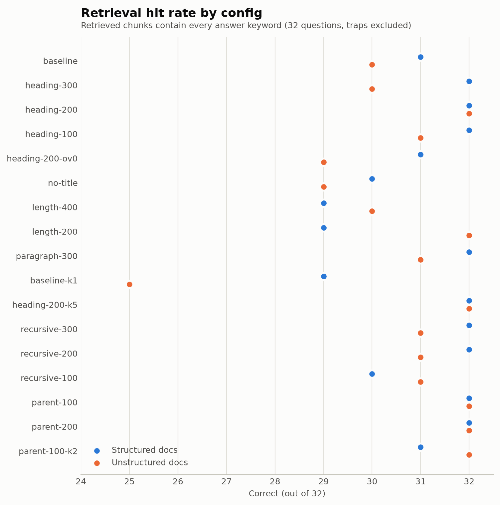
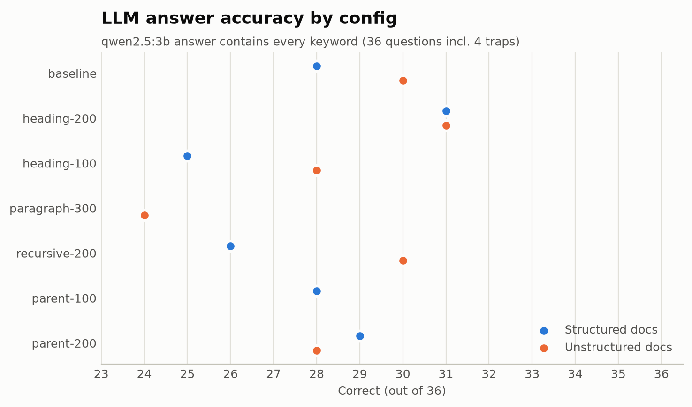
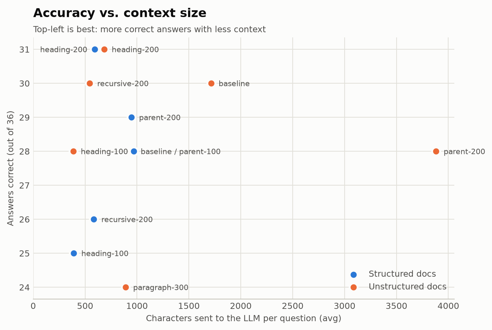
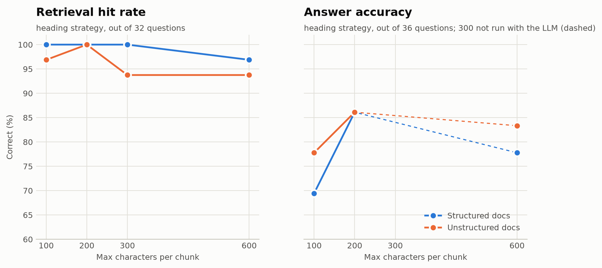
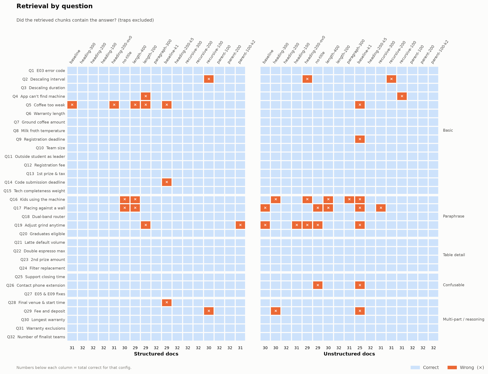
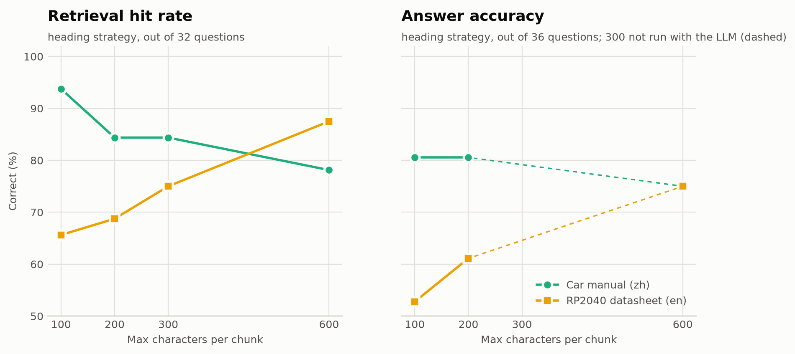
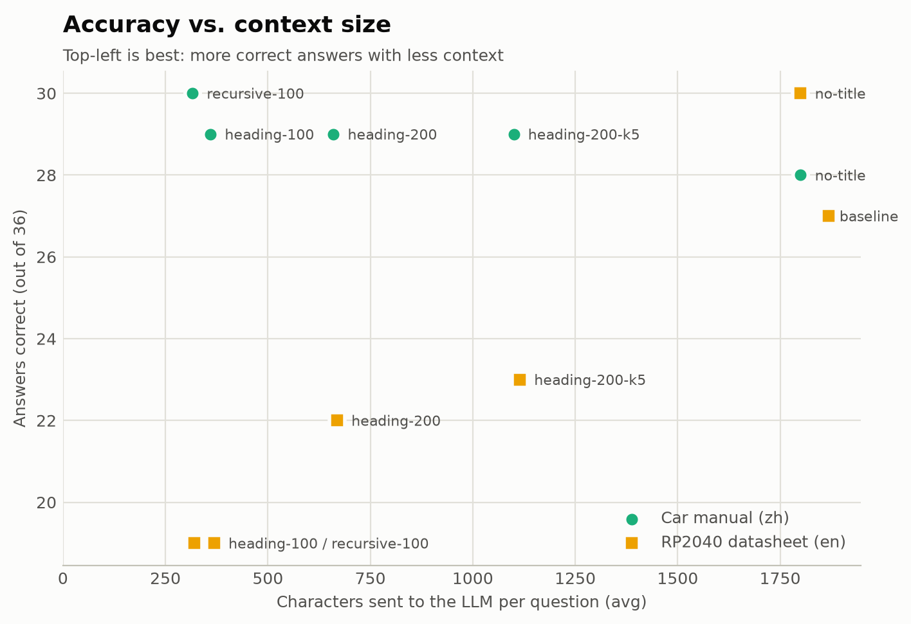
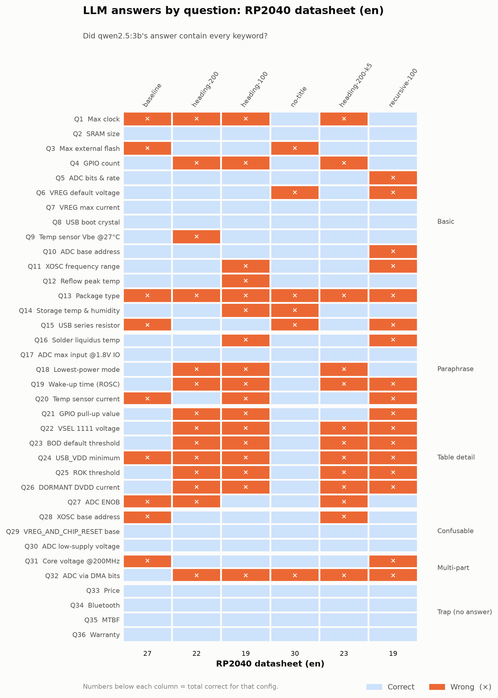

# 切段實驗：數據與結果

## 實驗目的

比較不同的切段方式、段落長度、重疊字數、段首標題、Top-K，對 RAG **檢索命中率**和 **LLM 回答正確率**的影響。

## 實驗設定

| 項目 | 設定 |
|---|---|
| 知識庫 | `data/` 裡 2 份 Markdown 文件：咖啡機使用手冊、黑客松活動辦法（每個 `## ` 章節約 50～390 字） |
| Embedding | Ollama `bge-m3`，cosine 相似度 |
| LLM | Ollama `qwen2.5:3b`，temperature 0.1 |
| 測試題 | `evaluate.py` 的 36 題：32 題一般題 + 4 題陷阱題（知識庫裡沒有答案） |
| 執行程式 | `experiment.py`，原始數據在 `results/` |

### 測試題組成

| 類型 | 題號 | 題數 |
|---|---|---|
| 基本題（文件裡直接寫的事實） | 1～15 | 15 |
| 換句話說（問法和文件用字不同） | 16～20 | 5 |
| 表格細節 | 21～24 | 4 |
| 容易混淆（兩份文件都有類似資訊） | 25～27 | 3 |
| 跨段落 / 推理 / 列舉 | 28～32 | 5 |
| 陷阱題 | 33～36 | 4 |

完整題目與標準答案見 `測試問題與標準答案.md`。

### 評分方式

- **檢索命中**：取回的段落合起來，有沒有包含該題所有關鍵字。只算 32 題一般題。
- **回答正確**：LLM 的回答有沒有包含所有關鍵字。36 題都算，陷阱題要回答「沒有提到」。
- **每題上下文字數**：平均每題交給 LLM 多少字。越少代表越省，也越不容易被不相關內容干擾。

### 比較的設定

| 設定 | 切段方式 | 每段上限 | 重疊 | 段首標題 | Top-K | 備註 |
|---|---|---|---|---|---|---|
| baseline | heading | 600 | 100 | ✅ | 3 | 最初的設定 |
| heading-300 / 200 / 100 | heading | 300 / 200 / 100 | 50 / 50 / 30 | ✅ | 3 | heading-200 是目前 `rag_core.py` 的設定 |
| heading-200-ov0 | heading | 200 | 0 | ✅ | 3 | 不重疊 |
| no-title | heading | 600 | 100 | ❌ | 3 | 拿掉段首標題 |
| length-400 / 200 | length | 400 / 200 | 100 / 50 | ✅ | 3 | 不看章節硬切 |
| paragraph-300 | paragraph | 300 | 50 | ✅ | 3 | 依空行切再合併 |
| baseline-k1 | heading | 600 | 100 | ✅ | 1 | |
| heading-200-k5 | heading | 200 | 50 | ✅ | 5 | |
| recursive-300 / 200 / 100 | recursive | 300 / 200 / 100 | 50 / 50 / 30 | ✅ | 3 | 遞迴切分 |
| parent-100 / 200 | heading | 100 / 200 | 30 / 50 | ✅ | 3 | 小段檢索、大段回答 |
| parent-100-k2 | heading | 100 | 30 | ✅ | 2 | 小段檢索、大段回答 |

註：baseline 每段上限 600 字，但所有章節都不到 600 字，所以其實沒有任何章節被再切小，等於「一個章節一段」。

## 結果一：檢索命中（32 題一般題）

資料來源：`results/experiment_20261020_142058.csv`

| 設定 | 段數 | 平均字數 | 檢索命中 | 每題上下文字數 | 沒命中的題號 |
|---|---|---|---|---|---|
| baseline | 25 | 244 | 31/32 | 963 | 5 |
| heading-300 | 29 | 222 | 32/32 | 784 | - |
| heading-200 | 41 | 183 | 32/32 | 594 | - |
| heading-100 | 74 | 126 | 32/32 | 391 | - |
| heading-200-ov0 | 40 | 166 | 31/32 | 583 | 5 |
| no-title | 25 | 206 | 30/32 | 849 | 16, 17 |
| length-400 | 17 | 420 | 29/32 | 1255 | 5, 16, 17 |
| length-200 | 35 | 222 | 29/32 | 673 | 4, 5, 19 |
| paragraph-300 | 22 | 263 | 32/32 | 827 | - |
| baseline-k1 | 25 | 244 | 29/32 | 322 | 5, 14, 28 |
| heading-200-k5 | 41 | 183 | 32/32 | 984 | - |
| recursive-300 | 24 | 262 | 32/32 | 837 | - |
| recursive-200 | 38 | 190 | 32/32 | 584 | - |
| recursive-100 | 74 | 111 | 30/32 | 350 | 2, 29 |
| parent-100 | 74 | 126 | 32/32 | 968 | - |
| parent-200 | 41 | 183 | 32/32 | 947 | - |
| parent-100-k2 | 74 | 126 | 31/32 | 670 | 19 |

### 觀察

1. **段落切小有幫助，但不能太碎。** baseline 漏掉第 5 題（咖啡太淡怎麼調）。依章節切到 100～300 字都能全部命中，上下文還更少。遞迴切分切到 100 字反而漏了 2 題，因為句子被切得太碎。
2. **依結構切比硬切好。** 不看章節硬切（length）漏了 3 題，依章節（heading）、段落（paragraph）、遞迴（recursive）切都能全部命中。
3. **段首標題很重要。** 拿掉標題後，換句話說的第 16、17 題就找不到了。
4. **重疊有幫助。** 同樣 200 字，重疊 0 字就漏掉第 5 題。
5. **Top-K 不能太小。** 只取 1 段會漏 3 題，第 28 題跨段落的題目尤其需要多段。
6. **最省上下文的全命中設定**是 heading-100（391 字），其次是 recursive-200（584 字）和 heading-200（594 字），都不到 baseline 的 2/3。

## 結果二：LLM 回答正確（36 題）

LLM 很慢，所以只挑 6 組代表性的設定來跑。

資料來源：`results/experiment_20261020_143644.csv`
指令：`python experiment.py --llm --only baseline,heading-200,heading-100,recursive-200,parent-100,parent-200`

| 設定 | 檢索命中 | 回答正確 | 每題上下文字數 |
|---|---|---|---|
| baseline | 31/32 | 28/36 | 963 |
| **heading-200** | **32/32** | **31/36** | 594 |
| heading-100 | 32/32 | 25/36 | 391 |
| recursive-200 | 32/32 | 26/36 | 584 |
| parent-100 | 32/32 | 28/36 | 968 |
| parent-200 | 32/32 | 29/36 | 947 |

### 觀察

1. **heading-200 最好**：回答 31/36，比 baseline 多 3 題，上下文還少了約 40%。
2. **檢索全命中不代表回答會對。** heading-100 和 recursive-200 檢索都是 32/32，回答卻比 baseline 還差。可能的原因是段落太碎，交給 LLM 的是零散片段，3B 模型比較難整合出完整答案。
3. **小段檢索、大段回答（parent）沒有明顯幫助。** parent-100 / 200 的回答（28、29 題）和 baseline（28 題）差不多。因為這兩份文件的章節本來就短，baseline 本來就是「一個章節一段」，parent 最後交給 LLM 的內容和 baseline 很接近（上下文字數也差不多）。章節很長的文件比較可能看出它的好處。
4. **同樣約 200 字，依標題切（31 題）比遞迴切分（26 題）好。** 依標題切的段落都在同一章節內，主題比較完整；遞迴切分可能把兩個章節的結尾和開頭合成一段。
5. 回答分數有隨機誤差，重跑一次差了最多 4 題（見「逐題結果：LLM 回答」），所以 heading-200 比 baseline 多 3 題**不能算是確定的進步**。

## 結果三：換成無結構的文件

前面的文件都有清楚的 `## ` 標題、列點和表格，可能讓「依標題切」占優勢。為了確認，另外做了一份**內容完全相同、但幾乎沒有結構**的版本放在 `data_plain/`：

- 沒有標題、沒有列點、沒有表格（表格都改寫成句子）
- 每份文件只有 3～4 個長段落（黑客松 1549 字分 3 段、咖啡機 2277 字分 4 段，每段約 400～710 字）
- 已用程式確認 32 題一般題的關鍵字都還在

因為沒有 `## ` 標題，`heading` 切法會把整份文件當成一個章節，等於退化成依字數硬切；段首標籤也只剩文件名稱。

### 檢索命中（32 題）

資料來源：`results/experiment_20261020_144415_data_plain.csv`
指令：`python experiment.py --data data_plain`

| 設定 | 有結構 | 無結構 | 無結構的每題上下文字數 | 無結構沒命中的題號 |
|---|---|---|---|---|
| baseline | 31 | 30 | 1714 | 17, 19 |
| heading-300 | 32 | 30 | 978 | 16, 29 |
| heading-200 | 32 | 32 | 684 | - |
| heading-100 | 32 | 31 | 386 | 19 |
| heading-200-ov0 | 31 | 29 | 678 | 2, 16, 19 |
| no-title | 30 | 29 | 1608 | 17, 19, 26 |
| length-400 | 29 | 30 | 1246 | 16, 17 |
| length-200 | 29 | 32 | 684 | - |
| paragraph-300 | 32 | 31 | 890 | 16 |
| baseline-k1 | 29 | **25** | 553 | 5, 9, 16, 17, 19, 26, 29 |
| heading-200-k5 | 32 | 32 | 1142 | - |
| recursive-300 | 32 | 31 | 775 | 17 |
| recursive-200 | 32 | 31 | 544 | 2 |
| recursive-100 | 30 | 31 | 322 | 4 |
| parent-100 | 32 | 32 | **3882** | - |
| parent-200 | 32 | 32 | **3882** | - |
| parent-100-k2 | 31 | 32 | **3882** | - |

註：無結構時 heading-200 和 length-200 的結果完全相同，因為沒有標題可以切，兩者做的事一樣。

### LLM 回答正確（36 題）

資料來源：`results/experiment_20261020_150308_data_plain.csv`
指令：`python experiment.py --data data_plain --llm --only baseline,heading-200,heading-100,recursive-200,paragraph-300,parent-200`

| 設定 | 有結構 | 無結構 | 無結構的每題上下文字數 |
|---|---|---|---|
| baseline | 28 | 30 | 1714 |
| **heading-200** | **31** | **31** | 684 |
| heading-100 | 25 | 28 | 386 |
| recursive-200 | 26 | 30 | 544 |
| paragraph-300 | （沒跑） | 24 | 890 |
| parent-200 | 29 | 28 | 3882 |

### 觀察

1. **heading-200（200 字 + 重疊 50）在兩種文件都是最好的**：檢索 32/32、回答 31/36。在無結構文件上它其實就是「依字數切 200 字」，代表這個長度本身就很合適，不只是靠標題。
2. **只取 1 段時，無結構文件掉很多**（29 → 25 題）。段落大又沒標題，一段裡混了很多主題，相似度比對比較不準，Top-K 太小就容易漏。
3. **小段檢索、大段回答（parent）在無結構文件上失去意義。** 沒有章節，「整個章節」就是整份文件，每題都把兩份文件全部交給 LLM（3882 字）。檢索雖然全命中，但等於沒有檢索，回答也沒有比較好（28 題）。parent 需要文件有合理大小的章節才有用。
4. **遞迴切分比較穩。** 有沒有結構，檢索都是 31～32 題，因為它本來就不依賴標題。在無結構文件上回答 30 題，和最好的設定差不多。
5. **依空行切（paragraph-300）在無結構文件上回答最差**（24 題）。原文段落有 400～700 字，超過 300 字上限，只能硬切。
6. **意外的發現：** baseline、heading-100、recursive-200 在無結構文件上的**回答**反而比有結構時好 2～4 題。可能的原因是表格被改寫成完整句子後，3B 模型比較容易讀懂；但差距接近隨機誤差，需要多跑幾次才能確定。

## 結果四：真實的說明書 PDF

前面的文件都是自己寫的，篇幅也很短。為了確認結論在真實文件上是否成立，改用兩份網路上公開的 PDF（用 `python download_manuals.py` 下載，有版權所以不放進 git）：

| 資料夾 | 文件 | 語言 | 篇幅 | 測試題 |
|---|---|---|---|---|
| `data_car/` | Honda FIT 2017 車主手冊 | 繁體中文 | 325 頁、約 12 萬字 | `tests_car.py` |
| `data_rp2040/` | RP2040 Datasheet（取簡介、電源、穩壓器、晶體振盪器、ADC、電氣規格） | 英文 | 49 頁、約 8.3 萬字 | `tests_rp2040.py` |

- 兩組測試題都是 36 題，題型分類和 `evaluate.py` 相同：基本、換句話說、表格、容易混淆、跨段落、陷阱題。
- RP2040 是**用中文問英文文件**，同時測試跨語言檢索。
- PDF 轉出來的文字沒有 `## ` 標題，所以 heading 切法等於依字數切（heading-200 和 length-200 的結果完全相同）。段首標籤只有檔名。

指令：`python experiment.py --data data_car --tests tests_car`、`python experiment.py --data data_rp2040 --tests tests_rp2040`

### 檢索命中（32 題）

資料來源：`results/experiment_20261109_141413_data_car.csv`、`results/experiment_20261109_135416_data_rp2040.csv`

| 設定 | 車主手冊（中文） | 每題字數 | RP2040（英文） | 每題字數 |
|---|---|---|---|---|
| baseline（600 字） | 25 | 1860 | 28 | 1869 |
| heading-300 | 27 | 960 | 24 | 969 |
| heading-200 | 27 | 660 | 22 | 669 |
| heading-100 | **30** | 360 | 21 | 369 |
| heading-200-ov0 | 24 | 660 | 21 | 669 |
| no-title | 26 | 1800 | **29** | 1800 |
| length-400 | 26 | 1260 | 24 | 1269 |
| paragraph-300 | 28 | 760 | 25 | 948 |
| baseline-k1 | **14** | 620 | 25 | 623 |
| heading-200-k5 | **32** | 1100 | 24 | 1115 |
| recursive-300 | 26 | 842 | 24 | 859 |
| recursive-200 | 25 | 565 | 21 | 540 |
| recursive-100 | 28 | 316 | 19 | 320 |
| parent-100 / 200 / 100-k2 | 32 | **119654** | 32 | **82955** |

### 觀察

1. **最佳的段落長度會因文件而異，200 字不是通用答案。**
   - 中文車主手冊：越小越好，heading-100 檢索 30/32，只用 360 字。
   - 英文 datasheet：剛好相反，越大越好，600 字的 baseline 28 題、no-title 29 題，200 字只有 22 題。
   - 可能的原因：200 個字元在中文約是一小段話，在英文只有約 35 個單字。再加上 datasheet 的表格被拆成一行一個數字，切太小的段落只剩零散的數字，看不出在講什麼。
2. **長文件很需要多取幾段。** 車主手冊只取 1 段時掉到 14/32；取 5 段（heading-200-k5）可以全部命中，每題也只用 1100 字。手冊有很多章節在講類似的事，例如胎壓、機油，對的段落常常排在第 2～5 名。
3. **重疊依然有幫助。** 同樣 200 字，不重疊時車主手冊從 27 掉到 24，RP2040 從 22 掉到 21。
4. **段首標題在 PDF 上沒有幫助。** PDF 沒有 `#` 標題，段首標籤只有檔名，拆掉後兩份文件反而都多 1 題。之前「標題很重要」的結論，前提是文件真的有章節標題。
5. **小段檢索、大段回答（parent）完全失效。** PDF 沒有章節，「整個章節」就是整份文件，每題都把 8～12 萬字交給 LLM，等於沒有檢索。檢索看起來全命中，但這個數字沒有意義。
6. **跨語言檢索有明顯弱點。** Q13「RP2040 是什麼封裝？」在所有設定都找不到，文件裡寫的是 package 和 QFN-56，「封裝」對不上 package。這類專有名詞、型號，加上關鍵字檢索（混合檢索）可能比較有幫助。
7. **PDF 表格會被打散。** 出題時發現，表格裡的數字和單位常被換行拆開（例如「4」「kV」分在兩行），連關鍵字比對都對不上，有 2 題因此換掉。這也是第 1 點英文 datasheet 切小段效果差的原因之一。

註：檢索不呼叫 LLM，embedding 每次結果都一樣，所以檢索分數沒有隨機誤差，可以直接比較。

### LLM 回答正確（36 題）

資料來源：`results/experiment_20261112_210016_data_car.csv`、`results/experiment_20261113_001918_data_rp2040.csv`
指令：`python experiment.py --llm --only baseline,heading-200,heading-100,no-title,heading-200-k5,recursive-100 --data <資料夾> --tests <題庫>`

LLM 很慢，所以只挑 6 組代表性的設定。parent 系列每題會交出 8～12 萬字，沒有意義，記憶體也撐不住，所以不跑。這次 `rag_core.py` 已改成 `TEMPERATURE = 0`、`SEED = 42`（見「限制」）。

| 設定 | 車主手冊：檢索 | 車主手冊：回答 | 每題字數 | RP2040：檢索 | RP2040：回答 | 每題字數 |
|---|---|---|---|---|---|---|
| baseline（600 字） | 25 | 27 | 1860 | 28 | 27 | 1869 |
| heading-200 | 27 | 29 | 660 | 22 | 22 | 669 |
| heading-100 | 30 | 29 | 360 | 21 | 19 | 369 |
| no-title | 26 | 28 | 1800 | **29** | **30** | 1800 |
| heading-200-k5 | **32** | 29 | 1100 | 24 | 23 | 1115 |
| recursive-100 | 28 | **30** | 316 | 19 | 19 | 320 |

檢索分數和前面只跑檢索的結果完全相同。

### 觀察（LLM 回答）

1. **回答的趨勢和檢索一樣：最好的段落長度要看文件。**
   - 中文車主手冊：除了 baseline（27 題），其他設定都在 28～30 題，彼此差不多。但小段只用 baseline 1/5～1/3 的字數，所以小段比較划算。
   - 英文 datasheet：差距很大。600 字的 no-title 答對 30 題，100 字的 heading-100、recursive-100 只有 19 題，差了 11 題。
2. **RP2040 切小段時，檢索沒找到的題目幾乎都答錯。** 例如 heading-200 檢索沒命中的 10 題全部答錯。多取幾段（heading-200-k5）只多答對 1 題，救不回來。所以在英文 datasheet 上，瓶頸是檢索。
3. **車主手冊的瓶頸是 LLM，不是檢索。** heading-200-k5 檢索 32 題全中，回答還是錯 7 題。有幾題在 6 組設定都答錯，換切法也救不回來：
   - Q16「小朋友可以坐副駕駛座嗎？」
   - Q25「換機油但不換濾清器要加多少？」（手冊裡有 3.4、3.6 等相近的數字）
   
   另外 Q28（指示燈亮了多久要回廠）、Q29（TPMS 校正）在 5 組答錯。
4. **RP2040 有些題目很難答對。** Q13「封裝」跨語言檢索找不到（見檢索觀察 6），6 組都答錯。Q32「DMA 讀 ADC 要設哪些位元」需要整合多處資訊，只有 baseline 答對。Q24「USB_VDD 最低電壓」只有 no-title 答對。
5. **陷阱題（Q33～36）12 次全部答對。** 兩份文件、6 組設定，模型都老實回答「沒有提到」，沒有亂編價格、馬力或保固。
6. **段首標題在 RP2040 上反而有害。** no-title 比 baseline 多答對 3 題，和檢索的觀察 4 一致：段首標籤只有檔名，對 PDF 沒有幫助。

## 結果五：改用 token 計算長度

結果四中，車主手冊 100 字最好，RP2040 600 字元最好，差了 6 倍。一個可能的原因是**語言**：同樣 200 個字元，中文是一小段話，英文只有約 35 個單字。如果改用 token 算長度，兩份文件的最佳長度變得接近，就代表語言是主因，規律可以簡化成「大約 N 個 token」。

做法：新增 `token` 切法（`experiment.py`），和 heading 一樣先依章節切，再用 embedding 模型 bge-m3 自己的 tokenizer 以 token 數切段，重疊 25%。段落是用 tokenizer 回傳的位置切原文，內容和原文一字不差。

### 每份文件幾個字元 = 1 個 token

| 文件 | 字元 | token | 每 token 幾個字元 |
|---|---|---|---|
| `data/`（有結構） | 5207 | 3512 | 1.48 |
| `data_plain/`（無結構） | 3826 | 2636 | 1.45 |
| `data_car/` 車主手冊 | 119636 | 76867 | 1.56 |
| `data_rp2040/` RP2040 | 82933 | 24190 | **3.43** |

### 檢索命中（32 題）

資料來源：`results/experiment_20261113_101620.csv`、`results/experiment_20261113_101704_data_plain.csv`、`results/experiment_20261113_103246_data_car.csv`、`results/experiment_20261113_103752_data_rp2040.csv`
指令：`python experiment.py --only token-32,token-64,token-128,token-256,token-512 --data <資料夾> --tests <題庫>`

| token 上限 | 有結構 | 無結構 | 車主手冊（平均字數） | RP2040（平均字元） |
|---|---|---|---|---|
| 32 | 30 | 29 | 28（69） | 20（132） |
| 64 | **32** | 30 | **30**（119） | 22（241） |
| 128 | 31 | **31** | 26（219） | 28（459） |
| 256 | **32** | 30 | 27（418） | **29**（898） |
| 512 | 31 | **31** | 23（815） | 26（1769） |

### 觀察

1. **語言不是主因。** 用字元算時，兩份 PDF 的最佳長度差 6 倍；改用 token 算，還是差 4 倍（車主手冊 64 token、RP2040 256 token）。所以「大約 N 個 token」這種通用規律不成立。
2. **改用 token 本身不會讓檢索變好。** 換算成字數後，分數和字元切法差不多：車主手冊 token-64（約 119 字）和 heading-100 都是 30 題；RP2040 token-256（約 900 字元）和 no-title（600 字元）都是 29 題。token 只是換了一個比較一致的長度單位。
3. **短文件切多大都差不多。** 自己寫的兩份文件只有約 3500 token，從 32 到 512 token 都命中 29～32 題。段落長度的影響主要出現在長文件裡，因為長文件裡有很多相似的段落在搶排名。
4. **太大也不行。** 兩份 PDF 到 512 token 都變差（車主手冊 30 → 23，RP2040 29 → 26）。
5. **推測：真正的差別在「一個完整的資訊」有多長。**
   - 車主手冊：一句話通常就是一個完整的資訊（例如「機油容量 3.6 公升」）。段落小，答案比較不會被其他內容稀釋。
   - RP2040：答案常在表格裡。PDF 轉成文字後表格變成一行一個數字，切小段時只剩數字，沒有表頭和說明。段落至少要大到能把表頭和數值包在同一段（約 128～256 token）。
   
   所以比較可能的規律是**段落要大到能裝下一個完整的資訊單位**：說明文字是一兩句話，表格則是整張表加上說明。這只是從兩份文件推測出來的，需要更多不同類型的文件來驗證。

## 結果六：混合檢索（向量 + 關鍵字）

結果四、五顯示最佳長度要看文件。業界通常不會替每份文件調長度，而是讓檢索流程本身不那麼依賴長度，混合檢索就是常見做法之一。這裡要看的是：**加上關鍵字檢索後，不同長度之間的差距會不會變小？**

做法（`experiment.py` 的 `hybrid` 設定）：
- 向量檢索和 **BM25** 關鍵字檢索各自排一次名，再用 **RRF**（Reciprocal Rank Fusion）合併：分數 = Σ 1 / (60 + 名次)。RRF 只看名次，所以不用管兩種分數的尺度不同。
- BM25 用 bge-m3 的 tokenizer 斷詞，中英文都能切，不用另外安裝斷詞套件。
- hybrid-100 / 200 / 300 / 600 的切法分別和 heading-100 / 200 / 300 / baseline 相同，只差在檢索方式。

### 檢索命中（32 題）：只用向量 → 混合檢索

資料來源：`results/experiment_20261113_105134.csv`、`results/experiment_20261113_105204_data_plain.csv`、`results/experiment_20261113_110035_data_car.csv`、`results/experiment_20261113_110609_data_rp2040.csv`（只用向量的分數來自結果一、三、四）
指令：`python experiment.py --only hybrid-100,hybrid-200,hybrid-300,hybrid-600 --data <資料夾> --tests <題庫>`

| 每段字數 | 有結構 | 無結構 | 車主手冊（中文） | RP2040（英文） |
|---|---|---|---|---|
| 100 | 32 → 31 | 31 → 32 | 30 → 28 | 21 → **12** |
| 200 | 32 → 31 | 32 → 32 | 27 → 29 | 22 → **19** |
| 300 | 32 → 32 | 30 → 32 | 27 → 28 | 24 → **20** |
| 600 | 31 → 32 | 30 → 31 | 25 → 28 | 28 → 28 |
| **最高 − 最低** | 1 → 1 | 2 → **1** | 5 → **1** | 7 → **16** |

### 觀察

1. **問題和文件同語言時，混合檢索讓長度變得不重要。** 車主手冊原本 25～30 題（差 5 題），加上混合檢索後都在 28～29 題（差 1 題）。改善最多的是大段落（600 字 25 → 28）：關鍵字把被長段落稀釋掉的答案找回來。
2. **但它讓結果更穩，不會讓最高分更高。** 車主手冊最好的 100 字反而從 30 降到 28。
3. **跨語言時，混合檢索反而有害。** RP2040 切 100 字時從 21 掉到 12。BM25 只看字面，中文問題和英文文件對得上的幾乎只有「RP2040」和數字，每題都有「RP2040」，所以 BM25 的排名接近亂排；RRF 又把它和向量排名看得一樣重，把對的段落擠了下去。600 字時沒變差，因為段落大時，向量檢索本身就很有把握。
4. Q13「封裝」在 hybrid-300、hybrid-600 找到了，但 BM25 在這題對得上的只有「RP2040」，「封裝」本身對不上 package，所以比較像是合併排名時剛好把它排了上來，不是關鍵字比對的功勞。

**結論：混合檢索不是萬用解。** 同語言時它能讓結果不受長度影響；跨語言時要先處理語言問題（見結果七）。

## 結果七：把問題翻成英文再檢索（RP2040）

結果六中，混合檢索在 RP2040 上變差，推測原因是中文問題和英文文件的字面對不上。業界常見的解法是 **query rewriting**：檢索前先用 LLM 改寫問題。這裡用回答問題的同一個 qwen2.5:3b 把中文問題翻成英文（temperature 0、固定 seed），**回答時仍用原本的中文問題**。

| 設定 | 向量檢索用 | BM25 用 |
|---|---|---|
| `hybrid-en-*` | 原本的中文問題 | 英文翻譯 |
| `vector-en-*` | 英文翻譯 | 不用 |

資料來源：`results/experiment_20261113_111653_data_rp2040.csv`，翻譯結果在 `results/experiment_20261113_111653_data_rp2040_translations.csv`
指令：`python experiment.py --only hybrid-en-100,…,vector-en-600 --data data_rp2040 --tests tests_rp2040`

### 檢索命中（32 題）

| 每段字數 | 只用向量（中文問題） | 混合（中文問題） | **混合（BM25 用英文）** | **只用向量（英文問題）** |
|---|---|---|---|---|
| 100 | 21 | 12 | 21 | 22 |
| 200 | 22 | 19 | **24** | 21 |
| 300 | 24 | 20 | 23 | **26** |
| 600 | 28 | 28 | **29** | **29** |
| Q13「封裝」找到幾次 | 0 / 4 | 2 / 4 | 3 / 4 | 2 / 4 |

### 觀察

1. **翻譯後，混合檢索不再有害。** 100 字從 12 回到 21，200 字從 19 升到 24。證實結果六變差的原因是跨語言：BM25 對得上字面後，它就能正常發揮。
2. **但整體只比「只用向量」好一點**（多 0～3 題）。bge-m3 本身就是多語言模型，中文問題直接比對英文文件已經做得不錯，翻譯能補的空間不大。
3. **Q13「封裝」終於找得到了。** 最乾淨的比較是「只用向量」：同樣的方法，只差在問題有沒有翻譯。中文問題 4 種長度都找不到；翻成「What kind of package is RP2040?」之後，300、600 字找到了。混合檢索加上翻譯是 3 / 4，最多。這種專有名詞是翻譯最有幫助的地方。
4. **切小段的問題還是在。** 不管怎麼翻譯、怎麼檢索，100～200 字都只有 21～24 題，600 字都有 28～29 題。**所以 RP2040 偏好大段落不是語言造成的**，和結果五的推測一致：比較可能是表格被打散，小段落裝不下一個完整的資訊。
5. **3B 模型的翻譯有錯，限制了效果：**

   | 題號 | 翻譯 | 問題 |
   |---|---|---|
   | Q6、Q7、Q25 | 穩壓器 → stabilizer | datasheet 用的是 regulator |
   | Q23 | BOD → Battery Off Detection | 應該是 Brown-Out Detection |
   | Q16 | 焊接 → welding | 應該是 soldering |
   | Q6、Q30 | 「开机」、「效能」 | 沒翻譯，直接留下中文 |

   換更大的模型翻譯，或在 prompt 裡提供專有名詞對照表，可能還有進步空間。

### 結果五～七的整體結論

| 因素 | 會影響什麼 | 證據 |
|---|---|---|
| **語言（跨語言）** | 關鍵字檢索失效、專有名詞找不到 | 結果六 RP2040 變差，翻譯後恢復；Q13 翻譯後才找到 |
| **語言（每個 token 幾個字）** | 不是最佳長度不同的主因 | 結果五：改用 token 算還是差 4 倍 |
| **文件的資訊單位（推測）** | 最佳段落長度 | 結果五、七：RP2040 不管怎麼檢索都偏好大段落 |
| **混合檢索** | 同語言時讓長度不那麼重要 | 結果六：車主手冊各長度的差距從 5 題縮到 1 題 |

下一步最直接的驗證是**讓表格保持完整**：用能辨識表格的方式解析 PDF，看 RP2040 切小段的表現能不能救回來（結果八）。

## 結果八：讓表格保持完整

做法（`experiment.py`）：
- **`--tables`**：讀 PDF 時用 pymupdf 的 `find_tables()` 辨識表格，轉成 Markdown 表格（每一列是完整的一行）。其他文字維持 PDF 原本的閱讀順序，表格放在原本的位置。RP2040 找到 69 個表格。
- **`table` 切法**：一般文字照舊切；表格按列切，每段 = 表格前的說明（最多 3 行，跳過頁碼和頁首頁尾）+ 表頭 + 幾列。就算超過字數上限，也至少放一列，確保每一列都和表頭在同一段。例如：
  ```
  electrical specifications can be found in Chapter 5.
  |Name|Description|
  |---|---|
  |VREG_VOUT|Power output for the internal core voltage regulator, nominal voltage 1.1V, 100mA max current|
  ```
- 檢查過：32 題的答案在表格版的文字裡都還找得到，每一列表格都有放進某一段。

> 第一次實作時，文字區塊依座標由上到下重新排序，兩欄排版的頁面左右欄因此交錯，車主手冊 100 字從 30 掉到 22。改成維持原本的閱讀順序後重跑，沒有表格的頁面文字和純文字版完全相同。以下是修正後的結果。

資料來源：`results/experiment_20261113_120935_data_rp2040_tables.csv`、`results/experiment_20261113_122839_data_car_tables.csv`（純文字的分數來自結果四）
指令：`python experiment.py --tables --only baseline,heading-300,heading-200,heading-100,table-100,table-200,table-300,table-600 --data <資料夾> --tests <題庫>`

### 檢索命中（32 題，只用向量檢索）

| 每段字數 | 車主手冊：純文字 | 表格版 + 原切法 | **表格版 + 按列切** | RP2040：純文字 | 表格版 + 原切法 | **表格版 + 按列切** |
|---|---|---|---|---|---|---|
| 100 | 30 | 26 | **30** | 21 | 20 | 22 |
| 200 | 27 | 26 | **29** | 22 | 20 | 23 |
| 300 | 27 | 27 | **31** | 24 | 25 | 25 |
| 600 | 25 | 28 | **29** | 28 | 28 | 27 |
| 最高 − 最低 | 5 | 2 | **2** | 7 | 8 | 5 |

註：table 切法的段落比同名的 heading 長一點（一列加上表頭和說明可能超過上限），例如 RP2040 table-100 平均 144 字元、heading-100 是 123 字元。

### 觀察

1. **和預期相反：表格解析幫到的是車主手冊，不是 RP2040。**
   - 車主手冊用「表格版 + 按列切」後，4 種長度都有 29～31 題，table-300 的 **31/32** 是這份手冊只取 3 段時的最高分；各長度的差距也從 5 題縮到 2 題。手冊最後的規格表（容量、尺寸、燈泡）保持完整後，大段落也不會被稀釋。
   - RP2040 只多了 0～1 題，切小段的問題還在（100～200 字 22～23 題，600 字 27～28 題）。
2. **只換解析、不按列切，沒什麼幫助。** 「表格版 + 原切法」在兩份文件上都和純文字差不多，甚至略差：表格轉成 Markdown 後如果還是照字數硬切，表頭和數值一樣會被分開。**解析和切法要一起改才有用。**
3. **RP2040 為什麼救不回來？** 逐題檢查 table-200 沒找到的題目，第一個含答案的段落排在第幾名：

   | 題目 | 答案在哪裡 | 排名 | 原因 |
   |---|---|---|---|
   | Q19 喚醒時間、Q24 USB_VDD 最低電壓、Q25 ROK 門檻 | **一般文字**，不是表格 | 5～19 | 技術說明很密集，切小段後少了前後文 |
   | Q21 上拉電阻 | 表格（電氣規格） | 69 | 段落只有表頭和「Pull-Up Resistance｜50｜80｜kΩ」，沒有「GPIO」，也沒有表格標題 |
   | Q23 BOD 門檻 | 表格（暫存器） | 16 | 跨頁的表格，第二頁那段沒有「BOD」這個字 |
   | Q26 DORMANT 電流 | 表格（耗電） | 7 | 表頭很長，答案在很多欄的其中一格 |

   所以 RP2040 切小段會失敗，**不只是因為表格被打散**：一半的題目答案在一般文字裡，另一半在表格裡，但表格那段缺少「這是什麼東西的規格」這種上下文。光是保持表格完整還不夠。
4. **這正是 Anthropic「Contextual Retrieval」要解決的問題**：用 LLM 幫每一段寫一句「這段在講什麼」（例如「GPIO 電氣規格表：上拉電阻」）再放到段首。我們的段首標題只有檔名，PDF 又沒有章節標題，所以每一段都缺少上下文。

### 修正後的推測

結果五推測「段落要大到能裝下一個完整的資訊單位」，這次的結果把它修正為：**每一段都要帶著足夠的上下文。**
- 車主手冊：一句話本身就有上下文（「機油容量 3.6 公升」），只要表格保持完整就很穩。
- RP2040：一行數字或一句技術說明，本身看不出在講哪個模組。段落大時，上下文剛好被包進來；段落小時就會遺失。所以它才偏好大段落。

驗證方法：幫每段加上 LLM 產生的上下文，看 RP2040 切小段能不能救回來（結果九）。

## 結果九：Contextual Retrieval（RP2040，200 字）

做法（`experiment.py` 的 `context` 設定）：參考 Anthropic 的 Contextual Retrieval，用 LLM 幫每段寫一句「這段在講什麼」放在段首，向量化和回答時都包含這句。
- 原本的做法是把**整份文件**和這段一起交給 LLM。RP2040 有 8 萬多字，3B 模型讀不了，所以只給**這段前面約 1500 字** + 這段本身。
- 用回答問題的同一個 qwen2.5:3b，temperature 0、固定 seed。553 段每段約 3 秒，共約 30 分鐘。產生的句子存在 `cache/`（不進 git），重跑不用再產生。
- **評分只看原本的段落內容**：LLM 看過前面 1500 字，寫出來的句子可能剛好含有答案的數字，算進去會讓分數虛高。

產生的句子例如：
```
This chunk describes the ROKTH thresholds in the VREG register for the voltage regulator module in the document.
This chunk describes the round-robin sampling feature within the ADC module, as described in the section on Sampling Multiple Inputs.
```

資料來源：`results/experiment_20261113_132019_data_rp2040.csv`
指令：`python experiment.py --only context-200 --data data_rp2040 --tests tests_rp2040`

### 結果

| | heading-200（沒有上下文） | context-200 |
|---|---|---|
| 檢索命中（前 3 名） | 22/32 | 22/32 |
| 答案段落排在前 10 名的題數 | 26 | 28 |
| 排名中位數 | 2 | 2 |
| 排名變好 / 變差 / 不變 | | 6 / 7 / 19 |

排名變化最大的幾題（第一個含答案的段落排第幾名）：

| 題目 | 沒有上下文 | 有上下文 |
|---|---|---|
| Q23 BOD 預設門檻 | 53 | **1** |
| Q1 最高時脈 | 17 | **2** |
| Q19 從省電模式醒來要多久 | 82 | **16** |
| Q26 DORMANT 電流 | 14 | 7 |
| Q13 封裝 | 23 | 38 |
| Q21 上拉電阻 | 2 | 58 |

註：Q21 原本排第 2 名其實是關鍵字誤判（那段是穩壓器的說明，只是剛好含有「50」和「80」），所以它「變差」不代表上下文有害。Q32 的兩個關鍵字在 200 字的段落裡不會同時出現，這個長度下不可能命中。

### 觀察

1. **前 3 名的命中數沒有變（22 → 22）。** 這次沒有證實「加上下文就能救回小段落」。
2. **但對某些題目效果很大。** Q23「BOD」從第 53 名跳到第 1 名：原本那段只有一串電壓數值（「0.817V / 1001 - 0.860V (default) / …」），完全看不出在講什麼；加上「This chunk describes the BOD Register section in the VREG_AND_CHIP_RESET shared address space…」之後就找到了。這正是結果八推測的問題（段落缺少「這是什麼」的資訊），也證明了方向是對的。
3. **效果被 3B 模型的品質限制住了。** 很多句子只是把段落內容重述一次（「This chunk describes how CS.RROBIN allows the ADC to sample…」），沒有補上新的上下文，例如這段屬於哪一章、哪個模組。而且每句都以「This chunk describes」開頭，對檢索沒有幫助。
4. **只給前面 1500 字也有限制。** 段落所屬的章節標題常常在更前面，LLM 看不到。
5. **成本很高。** 每一段都要呼叫一次 LLM。200 字約 30 分鐘，100 字約 1 小時；文件更新時要重新產生。

### 結論

Contextual Retrieval 的方向是對的，對缺少上下文的段落效果很明顯（Q23、Q1、Q19），但用 3B 模型、只看附近內容的版本，整體分數沒有進步。要發揮效果，可能需要：
- 更大的模型，或者
- 不靠 LLM，直接把**段落所屬的章節編號和標題**（例如「2.10.4. Brown-out Detection」）加在段首。PDF 裡有這些編號，只是我們現在的段首標籤只放檔名。這個方法便宜、穩定，也不會有 LLM 亂寫的問題（結果十）。

## 結果十：段首加上所屬章節（`--sections`）

做法：段首標籤從「檔名」改成「檔名｜所屬章節」，段落內容完全不變。兩份 PDF 的章節資訊形式不同，所以用兩種規則（**這些規則是看過這兩份 PDF 後寫的，換一份文件可能要改**）：

| 文件 | 章節從哪裡來 | 段首標籤例子 |
|---|---|---|
| RP2040 | 內文裡帶編號的標題，依編號層級組成路徑（每頁重複的頁首只算第一次） | `rp2040-datasheet.pdf｜2.10. Core Supply Regulator > 2.10.4. Status` |
| 車主手冊 | 每頁頁首的麵包屑（「uu 安全帶u 關於安全帶」，u 是箭頭符號）和章名；新主題的第一頁沒有麵包屑，改用下一頁的 | `FIT_2017_車主手冊.pdf｜行車安全｜安全帶 > 關於安全帶` |

RP2040 抓到 84 個章節；車主手冊 92% 的段落有章節（沒有的是前面的目錄和快速參考）。PDF 書籤不夠用：車主手冊沒有書籤，RP2040 只有 32 個，而且只能定位到頁。

資料來源：`results/experiment_20261113_134001_data_rp2040_sections.csv`、`results/experiment_20261113_134617_data_rp2040_tables_sections.csv`、`results/experiment_20261113_135526_data_car_sections.csv`、`results/experiment_20261113_140621_data_car_tables_sections.csv`
指令：`python experiment.py --sections --only baseline,heading-300,heading-200,heading-100 …`、`python experiment.py --tables --sections --only table-100,table-200,table-300,table-600 …`

### 檢索命中（32 題）：只有檔名 → 加上章節

| 每段字數 | RP2040 | RP2040 表格版 | 車主手冊 | 車主手冊 表格版 |
|---|---|---|---|---|
| 100 | 21 → 22 | 22 → 21 | 30 → **26** | 30 → 28 |
| 200 | 22 → 22 | 23 → 23 | 27 → **25** | 29 → 29 |
| 300 | 24 → 25 | 25 → 25 | 27 → **24** | 31 → 29 |
| 600 | 28 → **30** | 27 → 27 | 25 → 24 | 29 → 29 |

### 觀察

1. **RP2040 的大段落進步：600 字從 28 升到 30**，是 RP2040 目前的最高分（不算 parent），只剩 Q3、Q13 沒找到。
2. **但小段落還是救不回來**（100～200 字 22 題）。例如 Q23 BOD 的段落標成「2.10.6. List of Registers」，太籠統了：真正有用的資訊是「BOD 暫存器」，那是表格標題，不是帶編號的章節。小段落需要的上下文比章節還要細。
3. **車主手冊反而變差**，小段落掉最多（100 字 30 → 26）。可能的原因：
   - 麵包屑是以「頁」為單位，同一頁的段落都拿到一樣的長標籤（10～20 字）。段落只有 100 字時，標籤佔了很大的比例，同一章的段落在向量上變得很像，反而更難分出哪段才有答案。
   - 規則不完美：主題在一頁中間換掉時，後半頁的段落會拿到錯的標籤。
   - 這和結果四的 no-title 一致：車主手冊的句子本身就看得出在講什麼，額外的標籤只是雜訊。
4. **結論：章節標籤要看文件。** 段落本身看不出主題時（datasheet）有幫助，尤其是大段落；段落本身就有主題時（車主手冊）反而是雜訊。

## 結果十一：能不能先量「自足性」，再決定要切多大？（`selfcontain.py`）

目的：結果四～十歸納出「段落越自足，越適合切小」。如果能在切段前量出文件的自足性，就能自動決定段落長度，不用每次都掃一輪。

做法：把文件用 token 切成 32 / 64 / 128 / 256（重疊 25%，不加段首標題），每種長度隨機抽 40 段量指標。

1. **第一版：直接問 LLM「只看這段，看得出在講什麼嗎？」**（是／否）→ **不能用**。qwen2.5:3b 在 569 段中回答「否」528 次（93%），連車主手冊 256 token 的段落也幾乎全判「否」。3B 模型當不了裁判，這組數字作廢。
2. **改用兩個不靠 LLM 下判斷的指標：**
   - **主題可找回率**：LLM 只看這段寫出主題（例如「雨刷臂鎖定操作」「VREG輸出調節」），再用主題檢索同一份文件的所有段落，這段排進前 5 名的比例。
   - **上下文相似度**：這段的向量，和「這段 + 前後各 128 token」的向量的 cosine 相似度（不用 LLM）。

資料來源：`results/selfcontain_log.txt`（車主手冊、RP2040 32～128 的那次被系統因記憶體不足中斷，逐段 CSV 沒有存到，數字以 log 為準）、`results/selfcontain_20261113_165930.csv`、`results/selfcontain_20261113_170516.csv`

### 結果

| 文件 | 最佳長度（結果五） | 主題可找回率 32 / 64 / 128 / 256 | 上下文相似度 32 / 64 / 128 / 256 | 段落總數（32 token） |
|---|---|---|---|---|
| 車主手冊 | 64 token | 45% / 57% / 50% / 70% | 0.722 / 0.783 / 0.842 / 0.880 | 3203 |
| RP2040 | 256 token | 57% / 57% / 62% / 70% | 0.710 / 0.783 / 0.852 / 0.885 | 1008 |
| data | 差不多（都 30～32） | 88% / 88% / 95% / 100% | 0.694 / 0.762 / 0.816 / 0.882 | 147 |
| data_plain | 差不多（都 29～31） | 95% / 92% / 100% / 100% | 0.685 / 0.763 / 0.815 / 0.883 | 111 |

### 觀察

1. **兩個指標都分不出車主手冊和 RP2040。** 照假設，車主手冊（最佳 64 token）應該明顯比 RP2040（最佳 256 token）自足，實際上幾乎一樣，RP2040 的主題可找回率甚至略高。**假設沒有得到支持。**
2. **上下文相似度只和段落長度有關。** 四份文件在同一長度下都差不到 0.04，看不出文件的差別，這個指標沒有用。
3. **主題可找回率主要反映段落總數。** data、data_plain 只有一兩百段，排進前 5 名很容易，所以接近 100%；車主手冊段數最多，分數最低。不是文件比較自足。
4. **為什麼量不出來：** LLM 幫 RP2040 段落寫的主題其實很具體（「ADC錯誤標志」「USB VBUS EN」），隨機抽的段落大多會自己提到名稱。RP2040 真正出問題的只是**答案所在的少數段落**，例如「1001 - 0.860V」這種數值表，名稱在很遠的表格標題。隨機抽樣量的是平均值，這類段落佔比很小，就被平均掉了。

### 結論

- 決定切多大，要看的不是「整份文件平均起來自不自足」，而是「**答案所在的段落**」自不自足。這要知道使用者會問什麼，光看文件量不出來。
- 目前最可靠的方法仍是：**準備 20～30 題真實問題，掃幾種長度，選最好的**（結果四、五的做法）。

### 改成只量含有答案的段落（`--answers`）

做法：用每題的關鍵字找出含有答案的段落。關鍵字出現在超過 3 段的題目（例如答案只是「80」）找不出哪段才是答案，略過，每份文件留下 17～25 題、28～39 段。量三個指標：

- **主題對得上問題**：LLM 只看這段寫出的主題，和問題的 cosine 相似度。
- **主題排名**：用主題檢索所有段落，這段排在前百分之幾。段落很少時百分比有下限（例如只有 18 段時，第 1 名也是前 5.6%），只適合比較同一長度。
- **上下文增益**：問題和「這段 + 前後各 128 token」的相似度，減掉問題和「這段」的相似度。**正的 = 加上前後文才更像在回答這題（段落不自足）；負的 = 加了前後文反而被稀釋（段落自足，旁邊在講別的事）。**

資料來源：`results/selfcontain_answers_log.txt`、`results/selfcontain_answers_20261113_*.csv`
指令：`python selfcontain.py --answers --data data_car`（四份文件各跑一次）

上下文增益（平均 ± 標準誤）：

| 文件 | 最佳長度（結果五） | 32 token | 64 token | 128 token | 256 token |
|---|---|---|---|---|---|
| 車主手冊 | 64 | **−0.049** ± 0.014 | **−0.055** ± 0.010 | **−0.047** ± 0.009 | −0.026 ± 0.008 |
| RP2040 | 256 | **+0.032** ± 0.014 | +0.004 ± 0.011 | +0.003 ± 0.009 | **−0.021** ± 0.006 |
| data | 差不多 | −0.003 ± 0.020 | +0.006 ± 0.016 | −0.004 ± 0.012 | −0.009 ± 0.010 |
| data_plain | 差不多 | −0.016 ± 0.015 | −0.001 ± 0.014 | −0.011 ± 0.012 | +0.010 ± 0.010 |

主題對得上問題（32 / 64 / 128 / 256）：車主手冊 0.611 / 0.602 / 0.568 / 0.525；RP2040 0.551 / 0.541 / 0.541 / 0.533；data 0.537 / 0.504 / 0.505 / 0.478；data_plain 0.586 / 0.513 / 0.506 / 0.515。

### 觀察（只量含答案的段落）

1. **上下文增益第一次分出了兩份 PDF。** 車主手冊在每種長度都是明顯的負值：答案段落自己就最像問題，把前後文加進來反而被稀釋（旁邊在講別的事），所以適合切小。RP2040 在 32 token 是正值（31 段中 20 段為正）：答案段落要靠前後文才看得出和問題有關；要到 256 token 才轉成明顯的負值，剛好是 RP2040 的最佳長度。
2. **data、data_plain 各長度都接近 0**，和它們「切多大都差不多」（結果五）一致。
3. 可以整理成一條候選規則：**從小到大試，選「上下文增益明顯小於 0」的最小長度**。照這條規則，車主手冊選 32（實際最佳 64，32 也有 28/32），RP2040 選 256（實際最佳 ✓），data 系列沒有明顯差別（實際也差不多 ✓）。
4. **主題對得上問題的差別不大。** 車主手冊在小段落較高（0.61 vs. 0.55），但差距只有約 2 個標準誤，而且 data 系列（切多大都好）反而比 RP2040 低，不能拿來預測。
5. **限制：**
   - 只有兩份文件的最佳長度有明顯差別，規則還需要更多文件驗證。
   - 要先有測試題才知道哪段含有答案，所以這個指標目前是「解釋」為什麼最佳長度不同，還不能取代掃描。要做到切段前自動判斷，下一步可以讓 LLM 從段落自動產生問題，再量上下文增益。
   - RP2040 是中文問題對英文段落，跨語言可能讓相似度整體偏低；不過上下文增益是同一個問題的兩個相似度相減，影響應該比較小。

### 不用測試題：LLM 自動出題（`--auto`）

目的：上面的上下文增益要先有人工測試題。改成自動出題，看沒有測試題時還量不量得出來。

做法：隨機挑文件中的位置，取那裡的 128 token，用規則從中間挑一個**帶單位的數值**（V、mA、kPa、秒、公升…，也包含「三十日」這類中文數字）當答案，請 LLM 寫出「答案是這個數值」的繁體中文問題，每份文件出 40 題（車主手冊試了 400 個位置只出到 38 題）。答案所在的段落就是「含有答案的段落」，量法和上面相同。

試過但放棄的做法：
- 請 qwen2.5:3b 同時出題和答案（JSON）：常把答案寫進問題欄、答案留空，40 題只有 15 題能用。
- 答案挑「任何數字」：PDF 裡挑到的多半是頁碼、章節編號、表格編號（「P. 112」「Table 631」「2.10.6」），出的題目沒有意義。所以改成一定要帶單位。

資料來源：`results/selfcontain_auto_log.txt`、`results/selfcontain_auto_20261116_*.csv`（為了支援結果十二的法律條文，數值規則加上中文數字後五份文件一起重跑；只有車主手冊的數字略有變動，規則選的長度不變）
指令：`python selfcontain.py --auto --data data_car`（四份文件各跑一次）

上下文增益（平均 ± 標準誤，括號內是正值的比例）：

| 文件 | 最佳長度（結果五） | 32 token | 64 token | 128 token | 256 token |
|---|---|---|---|---|---|
| 車主手冊 | 64 | −0.009 ± 0.018（21/38） | **−0.039** ± 0.010 | −0.025 ± 0.009 | −0.025 ± 0.006 |
| RP2040 | 256 | **+0.044** ± 0.016（27/40） | −0.021 ± 0.012 | **−0.029** ± 0.006 | −0.017 ± 0.007 |
| data | 差不多 | −0.043 ± 0.021 | −0.044 ± 0.018 | −0.036 ± 0.011 | −0.018 ± 0.010 |
| data_plain | 差不多 | −0.084 ± 0.020 | −0.079 ± 0.013 | −0.056 ± 0.009 | −0.022 ± 0.005 |

### 觀察（自動出題）

1. **最重要的訊號重現了：只有 RP2040 在 32 token 是正的**（40 題中 27 題為正），和人工測試題的結果（+0.032）一致。其他三份文件在 32 token 都是 0 或負的。
2. 用「上下文增益明顯小於 0（超過 2 個標準誤）的最小長度」這條規則：

   | 文件 | 規則選的長度 | 那個長度的檢索命中（結果五） | 實際最佳 |
   |---|---|---|---|
   | 車主手冊 | 64 | 30/32 | 64（30/32）✓ |
   | RP2040 | 128 | 28/32 | 256（29/32），差 1 題 |
   | data | 32 | 30/32 | 64、256（32/32），差 2 題 |
   | data_plain | 32 | 29/32 | 128、512（31/32），差 2 題 |

   車主手冊選中最佳長度，RP2040 選到「次佳、只差 1 題」，**最重要的是沒有把 RP2040 選成小段**（RP2040 切 32 token 只有 20/32）。data 系列選得偏小，差 2 題。
3. **只有正負號可靠，數值大小不能用。** data_plain 在 32 token 的負值最大（−0.084），但它切 32 token 時其實是自己最差的（29/32）。所以這個指標適合回答「該不該切大一點」，不適合精細挑出最佳長度。
4. 自動出題的品質不穩定：例如「2. A」被當成帶單位的數值；有些問題和答案對不上（問 ROK 狀態欄位，答案卻是 1.10V）。換更大的 LLM 出題應該會更準。

## 結果十二：新文件的事前預測（勞動基準法）

結果十一的規則是看過四份文件的結果後才整理出來的。要確認它真的能「預測」，換一份沒用過的文件，**先預測、先 commit，再出題驗證**。

| 項目 | 內容 |
|---|---|
| 文件 | 勞動基準法全文（`data_law/勞動基準法.txt`，由 `download_manuals.py` 從全國法規資料庫下載；法律條文不受著作權保護，有放進 git） |
| 篇幅 | 約 4.4 萬字、98 條，純文字（沒有 `## ` 標題，章名和「第 X 條」各佔一行） |
| 特色 | 和前四份都不同類型：數字多用中文寫（「三十日」「四十五萬元」），常用「前項」「第一款」引用別處 |
| 測試題 | `tests_law.py`：基本 15、換句話說 5、**要靠上下文 7**（答案在款、項裡，主題在條文開頭）、容易混淆 3（罰則）、跨段落 2、陷阱 4 |
| 順序 | 1. `selfcontain.py --auto` 預測 → 2. 寫下預測並 commit（`results/law_prediction.md`，commit a9d0df9）→ 3. 跑檢索實驗驗證。測試題是在預測跑的同時、還沒看到結果前寫的 |

### 預測

| 長度 | 上下文增益（自動出題） |
|---|---|
| 32 token | −0.000 ± 0.017（16/40 為正） |
| 64 token | **−0.030** ± 0.010 |
| 128 token | −0.046 ± 0.007 |
| 256 token | −0.020 ± 0.006 |

**預測：最適合 64 token；32 token 的增益接近 0、不是正的，所以 32 token 不會像 RP2040 那樣掉很多。**

### 驗證：檢索命中（32 題）

資料來源：`results/experiment_20261116_100143_data_law.csv`
指令：`python experiment.py --data data_law --tests tests_law --only token-32,…,hybrid-600`

| token | 32 | 64 | 128 | 256 | 512 |
|---|---|---|---|---|---|
| 檢索命中 | 29 | **30** | **30** | 29 | **30** |

| 每段字數 | 100 | 200 | 300 | 600 |
|---|---|---|---|---|
| 依字數切（heading） | 29 | 30 | 30 | 29 |
| 遞迴切分 | 30 | 30 | | |
| 混合檢索 | 31 | 31 | **32** | 31 |
| 不加段首標題 | | | | 31 |

用測試題量的上下文增益（`--answers`）：32 / 64 / 128 / 256 token 都是負的（−0.027 / −0.039 / −0.037 / −0.034）。

### 觀察

1. **預測成立，但只是「弱驗證」。** 預測的 64 token 是最高分（30，和 128、512 同分）；32 token 只少 1 題，沒有像 RP2040 那樣崩掉（RP2040 32 token 是 20/32），這兩點都對。但勞動基準法**各長度只差 1 題**，切多大都差不多，所以「選中最佳長度」本身說服力有限。
2. 這個結果和規律一致：**法條的答案段落是自足的**（「勞工正常工作時間，每日不得超過八小時」主題和數值在同一句），上下文增益在每種長度都是負的，所以切小也沒問題。「要靠上下文」的 7 題（答案在款、項裡）幾乎都找得到（16 組設定中只有 hybrid-200 漏了 Q23），因為款、項本身就寫了「三年以上者，於三十日前預告之」這類完整的資訊。
3. **混合檢索幫助最大**：hybrid-300 32/32，是所有設定中唯一全中的。法條用字固定（「延長工作時間」「資遣費」），問題裡的詞常常直接出現在條文中，關鍵字檢索很有效。和車主手冊（同語言）的結論一致。
4. 切小段（100～300 字、64～128 token）的設定大多漏掉 **Q2「一天最多工作幾小時」**（答案「十二小時」在第 32 條第二項，開頭是「前項雇主延長勞工之工作時間連同正常工作時間」），和 **Q28「強制勞動的罰金」**（罰則章的條文只寫「違反第五條規定者」，看不出第五條是強制勞動）。這兩題正是「要靠別的條文才看得懂」的例子：段落大時（baseline、no-title）Q2 找得到，混合檢索也找得到。但只佔少數，平均起來不影響最佳長度。

## 結果十三：事前預測「要切大」的文件（ESP32-C3 技術規格書）

結果十二只驗證了「增益不是正的 → 切小也沒問題」。另一半「**增益為正 → 要切大**」只有 RP2040 一個例子，而 RP2040 又是跨語言（中文問英文），分不清是哪個原因。所以找一份**中文、表格很多**的規格書，做同樣的事前預測。

| 項目 | 內容 |
|---|---|
| 文件 | 樂鑫 ESP32-C3 系列芯片技術規格書 v2.5（`data_esp32/`，簡體中文 PDF，73 頁、約 5.9 萬字；有版權，不進 git，用 `download_manuals.py` 下載） |
| 特色 | 管腳表、電氣特性表、功耗表很多；PDF 轉文字後表格變成一行一個值（和 RP2040 一樣） |
| 測試題 | `tests_esp32.py`（繁體中文問題、簡體中文文件）：基本 15、換句話說 5、表格 7、容易混淆 3、跨段落 2、陷阱 4 |
| 順序 | 1. `selfcontain.py --auto` 預測 → 2. 寫下預測並 commit（`results/esp32_prediction.md`，commit 62237a3）→ 3. 跑檢索實驗驗證。測試題是在預測跑的同時、還沒看到結果前寫的 |

### 預測

| 長度 | 上下文增益（自動出題，23 題） |
|---|---|
| 32 token | **+0.083** ± 0.018（21/23 為正） |
| 64 token | **+0.062** ± 0.015（20/23 為正） |
| 128 token | −0.016 ± 0.011 |
| 256 token | −0.013 ± 0.010 |

32、64 token 都明顯是正的（比 RP2040 的 +0.044 還大），128 token 起才轉負。寫下的預測：
1. 32、64 token 會明顯比 128、256 token 差（預期差 3 題以上）。
2. 最佳長度在 128 token 以上。
3. 如果成立，「要切大」就不是跨語言造成的。

（試了 400 個位置只出到 23 題：帶單位的數值大多在表格裡一行一個值，例如「45」和「kΩ」分在兩行，規則挑不到。）

### 驗證：檢索命中（32 題）

資料來源：`results/experiment_20261116_105700_data_esp32.csv`
指令：`python experiment.py --data data_esp32 --tests tests_esp32 --only token-32,…,hybrid-600`

| token | 32 | 64 | 128 | 256 | 512 |
|---|---|---|---|---|---|
| 檢索命中 | **18** | 25 | **27** | 26 | 21 |
| 平均字數 | 81 | 134 | 240 | 452 | 872 |

| 每段字數 | 100 | 200 | 300 | 600 |
|---|---|---|---|---|
| 依字數切（heading） | 24 | 25 | 28 | 27 |
| 遞迴切分 | 28 | **30** | | |
| 混合檢索 | 25 | 25 | 27 | 27 |
| 不加段首標題 | | | | 26 |

### 觀察

1. **預測大致成立。**
   - ✓ 32 token 崩掉：只有 18/32，比 128 token 少 9 題，和 RP2040（20/32）一樣。對照勞動基準法（增益 −0.000）32 token 還有 29/32。**32 token 時增益的正負號，正確分出了「會崩」和「不會崩」的文件。**
   - △ 64 token 只比 128 token 少 2 題（25 vs. 27），沒有達到預測的「3 題以上」。增益 +0.062 看起來很大，實際影響沒那麼大。
   - ✓ 最佳在 128 token（27/32）；但 512 token 又掉到 21，太大也不行。
   - ✓ 中文文件也要切大，**所以「要切大」不是跨語言造成的**，而是答案段落本身看不懂（結果八～十的推測）。
2. **32 token 失敗的題目集中在表格題**：表格和容易混淆的 Q21～Q30（都是表格裡的數值）10 題中有 7 題沒找到。例如「内部弱上拉电阻」和「45」「kΩ」各佔一行，切 32 token 時名稱和數值常被分到不同段。
3. **遞迴切分 200 字最好（30/32）**，比同長度依字數硬切（25）多 5 題。遞迴切分會優先在空行、換行處切，比較不會把表格的一列切斷。
4. **混合檢索幾乎沒有幫助**（25～27），和車主手冊、勞動基準法不同。可能的原因是繁體問題對簡體文件（「電流」vs.「电流」），BM25 只看字面，對不上。換句話說的 Q16、Q17 在 4 種混合檢索都沒找到。
5. **用測試題量的上下文增益（`--answers`）這次不準**：32 / 64 / 128 / 256 token 都是負的（−0.013 / −0.035 / −0.027 / −0.013），沒有分出 ESP32 要切大。原因是出題方式造成的偏差：表格題的關鍵字同時要求名稱和數值（例如「内部弱上拉电阻」+「45」），只有把兩者包在一起的段落才會被當成「含有答案的段落」，正好排除了看不懂的段落。RP2040 的關鍵字大多只有數值，所以沒有這個問題。**自動出題只挑數值，反而比較不受影響。**

### 結論

| 文件 | 32 token 的增益 | 預測 | 32 token 實際 | 最佳 |
|---|---|---|---|---|
| 勞動基準法（結果十二） | −0.000 | 切小沒問題 | 29/32 | 64 token（30） |
| ESP32-C3（結果十三） | **+0.083** | 要切大 | **18/32** | 128 token（27） |

兩份都是事前預測，兩份都說對了「32 token 會不會崩」。**「上下文增益的正負號」現在有兩個事前預測的例子支持**（加上事後分析的四份文件，共六份文件結果一致）。但它對「最佳長度在哪一格」的預測比較粗（ESP32 的 64 token 沒有像預期那麼差）。

## 結果十四：第三次事前預測失準（維基百科條目）

再換一個領域：**中文百科條目**，敘述文為主、有細的章節標題。

| 項目 | 內容 |
|---|---|
| 文件 | 維基百科「臺灣高速鐵路」條目（`data_wiki/台灣高鐵.md`，版本 95134586，約 2.4 萬字；CC BY-SA 4.0，有放進 git，來源見 `data_wiki/ATTRIBUTION`） |
| 格式 | 用 API 取純文字，「== 章 ==」「=== 節 ===」轉成 `## 章｜節`，共 36 個章節；每節多半只有 1～3 段長段落 |
| 測試題 | `tests_wiki.py`：基本 15、換句話說 5、**要靠上下文 7**（答案句省略主詞，例如「這款高鐵車輛共設有 989 個座位」）、容易混淆 3（相近的日期、數字）、跨段落 2、陷阱 4 |
| 順序 | 和結果十二、十三相同：預測 → commit（`results/wiki_prediction.md`，commit 5698067）→ 驗證 |

### 預測（32 token 為正 → 要切大）

| 長度 | 上下文增益（自動出題，40 題） |
|---|---|
| 32 token | **+0.040** ± 0.018（27/40 為正） |
| 64 token | −0.001 ± 0.013 |
| 128 token | **−0.019** ± 0.008 |
| 256 token | −0.023 ± 0.006 |

寫下的預測：32 token 會比 128 token 差 3 題以上；規則選 128 token。

### 驗證：預測失準

資料來源：`results/experiment_20261116_113833_data_wiki.csv`（有段首標籤）、`results/experiment_20261116_115328_data_wiki.csv`（不加段首標籤，`token-*-nt`）

| token | 32 | 64 | 128 | 256 | 512 |
|---|---|---|---|---|---|
| 有段首標籤（原本的設定） | **29** | 29 | 29 | 29 | 30 |
| 不加段首標籤 | **23** | 28 | 29 | 30 | 31 |

| 每段字數 | 100 | 200 | 300 | 600 |
|---|---|---|---|---|
| 依字數切（heading） | 27 | 29 | 28 | 30 |
| 遞迴切分 | 30 | 30 | | |
| 混合檢索 | 29 | 31 | 31 | **32** |

**原本的設定下，32 token 沒有崩（29/32），預測錯了。**這是三次事前預測中第一次失準。

### 為什麼會失準：段首的章節標題補上了上下文

- 拿掉段首標籤後，32 token 就從 29 掉到 **23**，比 128 token 少 6 題，**和預測說的一樣**。所以上下文增益量到的「段落本身看不懂」是真的，只是這份文件的段首標籤把缺的上下文補回來了。
- 例如 Q9「一列 700T 有幾個座位？」，答案句是「這款高鐵車輛共設有 989 個座位」，沒寫「700T」。不加標籤時找不到；加上「【台灣高鐵｜使用車輛｜700T型】」後就找到了。Q10、Q13、Q28、Q29、Q31 也是一樣：不加標籤時沒找到，加了就找到。
- 對照結果十：RP2040 加上章節路徑後，小段落還是救不回來。差別在**標題的粒度**：維基條目每節只有 1～3 段，「使用車輛｜700T型」就是答案段落的主題；RP2040 的章節很大，BOD 的數值表只被標成「2.10.6. List of Registers」，太籠統。
- 試著修正指標：`selfcontain.py --auto --labels` 讓段落和上下文都先加上段首標籤再量（和實際放進索引的段落一樣）。結果（`results/selfcontain_auto_labels_log.txt`）：

  | 文件 | 32 token（加標籤後） | 32 token 檢索（有標籤） |
  |---|---|---|
  | ESP32-C3 | +0.054 | 18（崩） |
  | 維基百科 | +0.027 | 29（沒崩） |
  | RP2040 | +0.024 | 20（崩） |
  | 勞動基準法 | +0.002 | 29 |
  | 車主手冊 | −0.004 | 28 |
  | data / data_plain | −0.049 / −0.059 | 30 / 29 |

  維基百科還是正的，而且和 RP2040 差不多，**加了標籤的版本也分不開**。上下文增益量的是「問題和段落有多像」，但標籤真正的作用是讓段落**和其他段落分得開**（「700T型」「N700ST」各自的段落不會混在一起），這一點相似度指標量不到。

### 結論

1. **上下文增益量到的是「段落本身」看不看得懂，這一點在維基百科上也是對的**（不加標籤時 32 token 確實崩了）。
2. **但它沒有考慮段首標籤能不能補救。** 文件有**細的章節標題**（每節只講一件事）而且段首加上標題時，小段落也能救回來；章節很粗（RP2040）或沒有章節（PDF）時救不回來。
3. 所以規則要改成兩步：
   - 先看文件有沒有細的章節標題。**有 → 段首加標題，切小也可以**（維基百科 32～128 token 都 29，混合檢索 600 字 32/32）。
   - 沒有（或很粗）→ 才用上下文增益判斷：32 token 為正 → 切大。
4. 三次事前預測：2 次成立（勞動基準法、ESP32-C3），1 次失準（維基百科），失準的原因找到了，但是是**事後**才找到的，修正後的規則還需要下一份文件來驗證。

## 結果十五：驗證修正後的兩步規則（退輔會常見問答）

選一份修正規則**之後**才找的文件：FAQ，每一題就是一個細的章節標題。

| 項目 | 內容 |
|---|---|
| 文件 | 國軍退除役官兵輔導委員會「常見問答」123 題（`data_faq/退輔會常見問答.md`，約 2.9 萬字；依該網站「政府網站資料開放宣告」註明出處即可利用，有放進 git，來源見 `data_faq/ATTRIBUTION`） |
| 格式 | 每題存成 `## 分類｜問題` 加答案，8 個分類；每節中位數 143 字（維基百科是 457 字），答案常是條列 |
| 測試題 | `tests_faq.py`：由**看不到任何預測或量測結果**的子代理只看文件出題。基本 14、換句話說 6、要靠上下文 7、容易混淆 3、跨段落 2、陷阱 4 |
| 順序 | 預測 → commit（`results/faq_prediction.md`，commit f3e66b4）→ 驗證 |

### 預測

| 長度 | 上下文增益：不加標籤 | 加段首標籤（`--labels`） |
|---|---|---|
| 32 token | **+0.046** ± 0.019 | −0.003 ± 0.010 |
| 64 token | −0.001 ± 0.014 | −0.016 ± 0.007 |
| 128 token | **−0.028** ± 0.009 | −0.027 ± 0.007 |
| 256 token | −0.021 ± 0.010 | −0.017 ± 0.008 |

依兩步規則寫下的三個預測：
1. 加段首標籤（原本的設定）：**切小也可以**，token-32 和最好的長度差不超過 2 題。
2. 不加標籤：增益為正，**token-32-nt 比最好的 -nt 長度少 3 題以上**。
3. 依標題切 + 混合檢索（hybrid-600，一段約一題 FAQ）：不低於最好的 token 設定減 1 題。

### 驗證：預測 1 失準，預測 2、3 成立

資料來源：`results/experiment_20261116_180258_data_faq.csv`（log：`results/experiment_faq_log.txt`）

| token | 32 | 64 | 128 | 256 | 512 |
|---|---|---|---|---|---|
| 有段首標籤（原本的設定） | **27** | 29 | 30 | 31 | **32** |
| 不加段首標籤 | **15** | 26 | 30 | 30 | 31 |

| 每段字數 | 100 | 200 | 600 |
|---|---|---|---|
| 依標題切（heading） | 30 | 31 | **32** |
| 遞迴切分 | | 31 | |
| 混合檢索 | | 31 | **32** |

1. **預測 1 失準**：有標籤時 token-32 是 27，比 token-512（32）少 5 題，超過預測的 2 題。
2. **預測 2 成立，而且很明顯**：不加標籤時 token-32 只有 15，比最好的少 16 題。段首標籤從 15 救回到 27，救回 12 題，但沒有全部救回。
3. **預測 3 成立**：hybrid-600 和 baseline（依標題切 600 字）都是 32/32。

### 為什麼加了標籤 32 token 還是少 5 題

用 token-32 的索引看這 5 題答案段落的排名：

| 題 | 答案段落排名 | 第 1 名的段落 |
|---|---|---|
| Q12 就養榮民亡故後遺眷的重點救助金 | 6 | **同一題 FAQ**，句子前半：「…５、就養榮民亡故，自亡故之日起六個月內，其無職業遺眷，」；金額「新臺幣三萬元」被切到下一段 |
| Q23 公費醫師分發服務幾年 | 8 | **同一題 FAQ**，另一條「服務年限至少6年」 |
| Q27 114 年起再任公職停領退休俸的薪資 | 12 | **同一題 FAQ**，句子前半：「註1：民國114年1月1日起…」；金額在下一段 |
| Q31 特殊度數＋寄達天數（兩個關鍵字、兩題 FAQ） | 7、4 | 同一題 FAQ |
| Q32 助聽器補助金額＋多久拿到（兩個關鍵字、兩題 FAQ） | 2、4 | 同一題 FAQ |

- **標籤都找對了 FAQ**：5 題的第 1 名都在正確的那一題裡。標籤解決的是「在哪一節」。
- 但同一節切成好幾個 32 token 小段時，**每段的標籤都一樣**，分不出哪一段才有答案；如果一句話被切成兩半（Q12、Q27：主詞和金額分在相鄰兩段），兩段都不完整。標籤救不了「一節裡面切斷句子」。
- Q31、Q32 是兩個關鍵字分在兩題 FAQ 的跨段落題，要兩段都進前 3 名，小段落本來就比較吃虧。
- 和維基百科的差別：維基百科切 32 token 時只少 1 題。原本以為是因為 FAQ 每節比較長，但量了之後**FAQ 每節反而比較短**（中位數 143 字 vs. 457 字），所以不是節的長度。比較可能的原因是 FAQ 有很多內容相近的題目（例如就醫服務 34 題，很多都是輔具、補助金額），同一節內和相鄰節之間都有相似的數字。這一點是**事後推測，還沒驗證**。

### 結論

1. **兩步規則的第二步再次成立**：不加標籤時，增益為正 → 32 token 崩（15/32）。上下文增益量到的「段落本身看不懂」在第四份文件上也是對的。
2. **第一步要修正**：細章節標題當段首標籤可以大幅補救小段落（15 → 27），但**不保證切小也沒問題**。比較穩的做法是**一節一段**：依標題切（600 字以內）+ 段首標題 + 混合檢索，在維基百科和 FAQ 上**都是 32/32**。
3. 事前預測累計：4 次中，勞動基準法、ESP32-C3 成立；維基百科失準；FAQ 三個預測中 2 個成立、「切小也可以」失準。

## 結果十六：改用別人人工標註的題庫（DRCD）

前面每份文件的測試題都是 AI 看著文件出的，每份只有 32 題。這次改用公開題庫 **DRCD**（台達研究院，人工標註的繁體中文閱讀理解資料集，CC BY-SA 3.0），題目不是我們出的，數量也多 100 倍。

| 項目 | 內容 |
|---|---|
| 知識庫 | DRCD test 的 378 篇維基百科文章**全部放進同一個索引**（約 43 萬字）：其他文章當干擾，比一篇一篇測更接近真實 RAG |
| 題目 | 3,493 題，答案中位數 4 個字 |
| 評分 | 取回的前 3 段裡，有沒有一段**涵蓋答案在原文中的位置**（同一篇、段落範圍包含整個答案）。只看答案字串會高估：只有 66% 的答案在文章中只出現一次 |
| 文件結構 | 只有文章標題，沒有章節標題 → 兩步規則的第二步（看上下文增益） |
| 順序 | 量增益 → 寫預測 → commit（`results/drcd_prediction.md`，commit 964c761）→ 跑完整實驗。寫預測前用前 20 篇試跑過程式（見預測檔） |
| 程式 | `drcd.py`（下載、接回整篇、換算答案位置）、`drcd_experiment.py`（比較切段設定） |

### 預測

上下文增益（`selfcontain.py --auto --data drcd`）：32 token **+0.058** ± 0.025、64 token +0.010、128 token −0.003 ± 0.010、256 token **−0.018** ± 0.006 → 規則選 **256 token**。

1. token-32 比最好的 token 長度低 5 個百分點以上。
2. 最好的 token 長度是 128 或 256，而且 256 和最好的差不超過 1 個百分點。
3. hybrid-200 比 heading-200 高、hybrid-600 比 baseline 高。

### 驗證：預測 1、3 成立，預測 2 一半成立

資料來源：`results/drcd_20261117_181225_test.csv`、逐題 `results/drcd_20261117_181225_test_per_question.csv`（log：`results/drcd_log.txt`）

| 設定 | 段數 | 平均字數 | 命中（看位置） | 標準誤 | 命中（看字串） |
|---|---|---|---|---|---|
| token-32 | 13,512 | 50 | **80.8%** | 0.7 | 84.4% |
| token-64 | 6,788 | 91 | 90.6% | 0.5 | 92.9% |
| token-128 | 3,426 | 172 | **92.6%** | 0.4 | 94.3% |
| token-256 | 1,748 | 322 | 90.9% | 0.5 | 93.0% |
| token-512 | 917 | 580 | 88.7% | 0.5 | 90.6% |
| heading-200 | 2,941 | 198 | 92.2% | 0.4 | 94.1% |
| baseline（600 字） | 970 | 514 | 88.4% | 0.5 | 90.5% |
| recursive-200 | 3,031 | 165 | 94.2% | 0.4 | 95.9% |
| **hybrid-200** | 2,941 | 198 | **96.0%** | 0.3 | 96.9% |
| hybrid-600 | 970 | 514 | 95.3% | 0.4 | 96.3% |

同一題比較兩種設定（成對差異，± 標準誤）：

| 比較 | 差距 | 只有前者命中 / 只有後者命中 |
|---|---|---|
| token-128 − token-32 | **+11.8** ± 0.7 | 535 / 124 |
| token-128 − token-256 | **+1.6** ± 0.4 | 141 / 84 |
| token-128 − token-64 | +2.0 ± 0.5 | 181 / 112 |
| hybrid-200 − heading-200 | **+3.8** ± 0.4 | 164 / 32 |
| hybrid-600 − baseline | **+6.9** ± 0.5 | 256 / 15 |
| recursive-200 − token-128 | +1.6 ± 0.4 | 133 / 76 |
| hybrid-200 − hybrid-600 | +0.7 ± 0.4 | 94 / 69 |

1. **預測 1 成立**：token-32 是 80.8%，比最好的 token-128 低 11.8 個百分點。
2. **預測 2 一半成立**：最好的 token 長度是 128（對），但規則選的 256 低了 1.6 個百分點（超過 1 個百分點，而且超過 3 個標準誤）。
3. **預測 3 成立**：混合檢索在兩種長度都明顯比較好（+3.8、+6.9 個百分點）。

### 觀察

- **上下文增益指對了方向，但選的長度大了一格。** 增益在 128 token 剛好接近 0（−0.003），規則要求「明顯小於 0」，所以選到 256；實際最好的是 128。ESP32-C3 也是增益剛轉負的那格（128）最好。這可能表示「增益剛好轉成不再是正的那格」比「明顯小於 0」更準，但這是**看過結果後的推測**，RP2040（規則選 128、實際 256 最好）是反例，還需要新文件事前驗證。
- **遞迴切分 200 字（94.2%）比所有固定 token 長度都好**，和兩步規則「最好用遞迴切分」一致。它有 20 段在原文中找不到位置（原因還沒查，可能是切分時改動了空白），這些段落一律算沒命中，所以實際分數只會更高。
- **混合檢索是最大的改善**：hybrid-200 96.0%、hybrid-600 95.3%，而且混合檢索後長度的影響變小（200 字和 600 字只差 0.7 個百分點，向量檢索時差 3.8）。和結果六一致：問題和文件同語言時，混合檢索讓長度沒那麼重要。
- **只看答案字串會高估 1～4 個百分點**，切越小高估越多（token-32 高估 3.6）：短答案常在別的段落出現。
- 和自己出的 32 題比起來，3,493 題時標準誤只有 0.3～0.7 個百分點，1～2 個百分點的差距也分得出來。

### 結論

1. **兩步規則第二步在別人的題庫上也成立**：增益為正 → 切太小會崩（80.8%），要切到 128 token 左右。
2. **規則對「切大還是切小」準，對「最佳在哪一格」偏粗**：這次選大了一格，少 1.6 個百分點。
3. **實務上最穩的設定是遞迴切分 200 字 + 混合檢索**（hybrid-200 96.0%）。
4. 事前預測累計 5 次：勞動基準法、ESP32-C3 成立；維基百科失準；FAQ 3 個預測中 2 個成立；DRCD 3 個預測中 2 個成立、1 個一半成立。

## 結果十七：DRCD dev 重現結果十六（三個預測都成立）

結果十六看過結果後想到另一種選法：「增益**剛轉成不是正的**那一格」。這次用完全沒跑過的 DRCD dev 驗證。預測檔：`results/drcd_dev_prediction.md`（commit 5394a37，**寫預測前沒有試跑**）。

| 項目 | 內容 |
|---|---|
| 知識庫 | DRCD dev 的 383 篇維基百科文章放進同一個索引（約 45 萬字） |
| 題目 | 3,524 題，評分和結果十六相同（看答案位置） |
| 增益 | 32 token +0.057（t +2.80）、64 +0.012、128 −0.018（t **−1.86**）、256 −0.017（t −2.52） |
| 兩種選法 | 原本的規則（明顯小於 0）→ **256**；新選法（第一個 ≤ 0）→ **128** |

### 結果

資料來源：`results/drcd_20261118_001337_dev.csv`、逐題 `results/drcd_20261118_001337_dev_per_question.csv`（log：`results/drcd_dev_log.txt`）

| 設定 | dev 命中（看位置） | test 命中（結果十六） |
|---|---|---|
| token-32 | **82.3%** | 80.8% |
| token-64 | 90.4% | 90.6% |
| token-128 | **92.3%** | **92.6%** |
| token-256 | 90.6% | 90.9% |
| token-512 | 87.5% | 88.7% |
| heading-200 | 92.0% | 92.2% |
| baseline（600 字） | 87.8% | 88.4% |
| recursive-200 | 93.7% | 94.2% |
| **hybrid-200** | **96.4%** | **96.0%** |
| hybrid-600 | 95.4% | 95.3% |

| 成對比較（dev） | 差距 | 只有前者命中 / 只有後者命中 |
|---|---|---|
| token-128 − token-256 | **+1.7** ± 0.4 | 151 / 91 |
| token-128 − token-32 | **+10.0** ± 0.7 | 487 / 135 |
| hybrid-200 − recursive-200 | **+2.7** ± 0.4 | 144 / 49 |
| recursive-200 − token-128 | +1.4 ± 0.4 | 128 / 78 |
| hybrid-200 − heading-200 | +4.4 ± 0.4 | 171 / 17 |
| hybrid-600 − baseline | +7.6 ± 0.5 | 276 / 9 |

1. **預測 1 成立**：token-128 比 token-256 高 1.7 個百分點（約 3.9 個標準誤）。新選法（128）比原本的規則（256）準。
2. **預測 2 成立**：token-32 比最好的 token-128 低 10.0 個百分點。
3. **預測 3 成立**：hybrid-200（96.4%）比所有不用混合檢索的設定都高；recursive-200 比 token-128 高 1.4 個百分點。

### 結論

1. **DRCD test 的結果在另一批文章、另一批題目上幾乎一模一樣重現**（每個設定差不到 1.5 個百分點）。3,500 題的結果是穩的。
2. 在 DRCD 上，**「增益剛轉成不是正的那格」比「明顯小於 0」準**（兩次都是 128 比 256 好約 1.7 個百分點）。但 RP2040 是反例（新選法選 64，只有 22/32；最好的是 256），所以**還不能直接換掉原本的規則**。比較保險的做法：兩種選法選出的長度都試，或直接加混合檢索讓長度沒那麼重要。
3. 實務上最穩的設定在兩組都一樣：**遞迴切分 / 依段落切 200 字 + 混合檢索**。
4. 事前預測累計 6 次：勞動基準法、ESP32-C3、DRCD dev 全部成立；維基百科失準；FAQ、DRCD test 各 3 個預測中 2 個成立。

## 圖表

以下圖表由 `python plot_results.py` 從上面的 CSV 產生，存在 `results/figures/`。藍色是有結構的文件（`data/`），橘色是無結構的文件（`data_plain/`）；真實說明書 PDF 的圖在最後一節。

### 各設定的檢索命中



大部分設定都在 29～32 題之間。只取 1 段（baseline-k1）在無結構文件上掉到 25 題最明顯。

### 各設定的 LLM 回答正確



heading-200 在兩種文件都是 31 題，是唯一兩邊都拿到最高分的設定。paragraph-300 只跑了無結構文件。

### 回答正確 vs. 交給 LLM 的字數



越靠左上越好。heading-200 用不到 700 字就答對最多題；無結構的 parent-200 交了將近 3900 字（等於全部文件），回答卻沒有比較好。

### 每段字數上限的影響（依標題切）



檢索命中率在 100～300 字都很高，但回答正確率在 **200 字**明顯最好：太小（100）段落太碎，太大（600）混進太多不相關內容。300 字沒有跑 LLM，所以右圖在 300 沒有點，用虛線把 200 和 600 接起來。

### 逐題結果：檢索



每一列是一題、每一欄是一個設定，橘色 × 代表取回的段落裡沒有答案。資料和「結果一」「結果三」相同。

- 失敗集中在少數幾題：**Q5（咖啡太淡）**、**Q16、Q17、Q19（換句話說）**。
- 無結構文件的換句話說題（Q16～Q19）失敗明顯變多，少了章節標題後，「小朋友」「緊貼牆壁」這類換句話說的問法比較難對上原文。
- 表格細節（Q21～Q24）在所有設定都 100% 找得到。

### 逐題結果：LLM 回答（重跑一次）


資料來源：`results/experiment_20261022_021218.csv`（有結構）、`results/experiment_20261022_022917_data_plain.csv`（無結構）
指令：`python experiment.py --llm --data <資料夾> --only baseline,heading-200,heading-100,paragraph-300,recursive-200,parent-100,parent-200`

之前的 CSV 只存了總分，沒有記錄每一題的對錯，所以為了畫這張圖又重跑了一次 LLM，這次 `experiment.py` 會在 `wrong` 欄位記下答錯的題號。

**重要發現：重跑的分數和第一次不一樣。** 程式和資料都沒變，但 LLM 的回答有隨機性：

| 設定 | 有結構：第一次 | 有結構：重跑 | 有結構：第三次 | 無結構：第一次 | 無結構：重跑 |
|---|---|---|---|---|---|
| baseline | 28 | 29 | 28 | 30 | 29 |
| heading-200 | **31** | **27** | 30 | 31 | 29 |
| heading-100 | 25 | 26 | 25 | 28 | 28 |
| recursive-200 | 26 | 27 | 26 | 30 | 29 |
| parent-200 | 29 | 29 | 28 | 28 | 29 |

第三次的資料來源：`results/experiment_20261023_010331.csv`（另外 paragraph-300 29、parent-100 28）。

heading-200 在有結構文件上三次分別是 31、27、30，最多差了 **4 題**。重跑時大部分設定都在 26～29 題之間，彼此的差距比「同一設定跑兩次」的差距還小。所以**單跑一次的回答分數，不足以判斷哪個切法比較好**。

**每個設定都答錯的題目**：Q12、Q30 在 14 欄全部答錯，Q17、Q18 也幾乎全錯，但這幾題的檢索都有找到答案。實際看模型的回答，是 3B 模型本身的錯誤，不是關鍵字比對太嚴格：

| 題目 | 模型的回答 | 問題 |
|---|---|---|
| Q12 報名費多少？ | 「報名費每隊新台幣 500 元。」 | 漏掉「全隊本校生 250 元」的優惠 |
| Q30 保固最長多久？ | 「保固最長可以延長到 3 年…」 | 沒有把「登錄再延長 6 個月」加上去 |
| Q17 可以緊貼牆壁嗎？ | 「資料中沒有提到」 | 參考資料裡有「至少 10 公分」，模型沒看出來 |
| Q18 雙頻路由器連不上？ | 「建議您改用 5GHz 網路…」 | 完全講反了，應該用 2.4GHz |

這些題目換切法也救不回來，要改善得靠更大的模型或更好的 prompt。

### 真實說明書 PDF（結果四）

以下圖表的資料和「結果四」相同。綠色圓點是車主手冊（中文），黃色方塊是 RP2040 datasheet（英文）。

#### 每段字數上限的影響



這張最能看出兩份文件**方向剛好相反**：車主手冊越小越好，RP2040 越大越好，兩條線在 300～600 字之間交叉。300 字沒有跑 LLM，所以右圖用虛線把 200 和 600 接起來。600 字時兩份都答對 27 題，點疊在一起。

#### 各設定的檢索命中


parent 系列沒有畫，因為 PDF 沒有章節，它們每題都把整份文件交出去，32/32 沒有意義。車主手冊的 baseline-k1（14 題）特別低，代表長文件只取 1 段很容易漏。

#### 回答正確 vs. 交給 LLM 的字數



車主手冊（綠色）集中在左上角：用 300～700 字就能答對 29～30 題。RP2040（黃色）剛好相反，要給到約 1800 字才答得好，左下角的小段落只答對 19 題。兩份文件的 baseline 都是 27 題、約 1860 字，點疊在一起。

#### 逐題結果：LLM 回答


車主手冊的錯誤集中在少數幾題：Q16（小朋友坐副駕駛）、Q25（不換濾清器的機油量）6 組全錯，Q28、Q29 也幾乎全錯。其他題目大多全對，所以換切法能改善的空間不大。



RP2040 的錯誤明顯和段落大小有關。表格題（Q21～Q27）在 600 字的 baseline、no-title 幾乎全對，切成 100～200 字後大多答錯。Q13（封裝）6 組全錯。陷阱題（Q33～36）兩份文件都全對。

## 結論與建議

- `rag_core.py` 已改用 **`MAX_CHARS = 200`、`OVERLAP = 50`**（= heading-200）。它在兩種文件上**檢索都全部命中**，交給 LLM 的字數也只有 baseline 的約 60%。**回答正確率**方面，第一次跑是最高分（31 題），但重跑只有 27～29 題，和其他設定差不多，所以「回答最準」這點還不能確定。
- 但換成真實的說明書 PDF 後（結果四），最佳長度就變了。中文車主手冊 100 字左右最好，回答 29～30 題，只用 300 多字。英文 datasheet 反而 600 字最好，回答 30 題；切成 100 字只剩 19 題。**換文件就要重新跑這組實驗**，不能直接套用 200 字。
- 原本推測中英文的差距和「字元」這個單位有關，但結果五改用 token 計算後，兩份 PDF 的最佳長度還是差 4 倍，**語言不是主因**。
- **結果四～十整理出來的規律：關鍵是「一段文字本身看不看得出在講什麼」（自足性）。**

  | | 段落本身看得出主題（車主手冊） | 段落本身看不出主題（RP2040 datasheet） |
  |---|---|---|
  | 例子 | 一句話寫完一項規格或操作，例如機油容量、胎壓 | 段落只剩一串數值：「1001 - 0.860V (default) / 1010 - 0.903V …」 |
  | 最佳長度 | 小（約 100 字 / 64 token） | 大（約 600 字元 / 256 token） |
  | 有效的改善 | 表格保持完整（結果八：各長度都 29～31） | 大段落 + 章節標籤（結果十：600 字 30/32） |
  | 沒用或有害 | 段首標籤、章節標籤（雜訊） | 切小段後再補救（表格、翻譯、LLM 上下文、章節標籤都救不回來） |
  | 混合檢索 | 讓各長度都穩定在 28～29（結果六） | 跨語言時有害，要先翻譯（結果六、七） |

  實務建議：**先看「答案所在的段落」能不能獨立看懂。** 能（答案旁邊就有名稱）→ 切小段、保持表格完整；不能（答案是一串數值，名稱在遠處的表格或章節標題）→ 切大段（至少 250 token 左右）、段首加章節。結果十一試過用隨機抽樣自動量自足性，但分不出這兩份文件；改成只量含有答案的段落後，「上下文增益」（加上前後文後和問題的相似度變化）分得出來：負的 → 切小，正的 → 切大，直到轉成負的為止。改用 LLM 自動出題（不用測試題）也量得出來：只有 RP2040 在 32 token 是正的。**所以沒有測試題時，可以先用自動出題量上下文增益，挑「增益明顯小於 0 的最小長度」當起點**（車主手冊選中最佳，RP2040 只差 1 題）；有測試題時，掃幾種長度仍然最準。這是從兩份文件歸納出來的，還需要更多不同類型的文件驗證。
- 重疊、Top-K ≥ 3 都要保留。文件結構越差、篇幅越長，Top-K 越不能小（車主手冊取 5 段才全部命中）。段首標題只在文件有章節標題時才有幫助。
- 文件**有好的章節結構**時，依標題切最簡單有效。文件**沒有結構**時（例如 PDF 轉出的純文字），遞迴切分或固定 200 字左右切都可以。
- 「小段檢索、大段回答」只適合章節長度適中的文件，章節很短（像這兩份）或沒有章節時都沒有幫助。
- 下一步可以嘗試：
  - ~~把 temperature 設成 0 並固定 seed~~（已完成，結果四用的就是這個設定）。可以重跑一次，確認分數真的完全相同。
  - ~~試試混合檢索（向量 + 關鍵字）~~（已完成，見結果六、七）。
  - ~~把「自足性」變成可以量的指標~~（已試，見結果十一：隨機抽樣量不出差別；只量含答案的段落時，「上下文增益」分得出來）。~~讓 LLM 自動出題取代測試題~~（已完成，見結果十一的 `--auto`：量得出 RP2040 需要切大）。~~拿新的文件先用 `--auto` 預測長度，再用測試題驗證~~（已完成勞動基準法，見結果十二：預測成立，但這份文件各長度只差 1 題，是弱驗證）。~~找一份「答案段落不自足」的新文件做事前預測~~（已完成 ESP32-C3，見結果十三：增益為正，32 token 果然崩到 18/32）。維基百科條目的事前預測失準（結果十四）：細的章節標題當段首標籤，能補救看不懂的小段落，上下文增益量不到這一點。~~用一份有細章節標題的新文件驗證修正後的兩步規則~~（已完成退輔會常見問答，見結果十五：第二步成立；第一步「切小也可以」失準，改成「一節一段 + 混合檢索」，維基百科和 FAQ 都 32/32）。改用別人人工標註的題庫 DRCD（結果十六，3,493 題）：第二步再次成立，但規則選的 256 token 比最好的 128 token 低 1.6 個百分點。~~用 DRCD dev 再驗證一次~~（結果十七：完全重現，128 比 256 好 1.7 個百分點）。下一步：換更大的 LLM 出題；找能量到「段落之間分不分得開」的指標；用其他類型的公開題庫（例如 ChiMDQA 的長 PDF）驗證。
  - 找更多不同類型的文件驗證上面的規律（例如法規條文、FAQ、論文、程式文件）。
  - 看 heading-200 答錯的 5 題是哪幾題，判斷是檢索問題、模型能力問題，還是關鍵字比對誤判。
  - 把表格改寫成句子後再比一次，確認觀察 6 是不是真的。
  - 換更大的 LLM（例如 `qwen2.5:7b`），看「換句話說」和「推理」題能不能答對。

## 限制

- **測試題和知識庫都很小。** 只有 2 份文件、32 題一般題，差 1～2 題可能只是巧合。很多設定都是 32/32，代表檢索這一關分不太出高下。
- **關鍵字比對可能誤判。** 例如模型回答「不行」，沒有出現「不得」，就會被判錯。關鍵字只是單一數字（例如 `3`、`5`、`7`）的題目，也可能剛好在別的段落出現而被算成命中。
- **LLM 回答有隨機性。** 結果一～三用的是 temperature 0.1，不完全固定，同一設定重跑，回答分數最多差了 4 題（見「逐題結果：LLM 回答」）。結果四改用 `TEMPERATURE = 0`、`SEED = 42`，理論上可以重現，但還沒有重跑驗證。每組也只跑一次，差 1～2 題的設定不能說誰比較好。
- **真實 PDF 的測試題是看著文件出的。** 每份只有 32 題一般題，而且 RP2040 只取了 49 頁，結果不一定能推廣到整份 datasheet。
- **無結構版本是人工改寫的。** `data_plain/` 是把同樣內容改寫成長段落，和真實的 PDF 轉文字（可能有亂碼、斷行錯誤、頁首頁尾）仍有差距。
